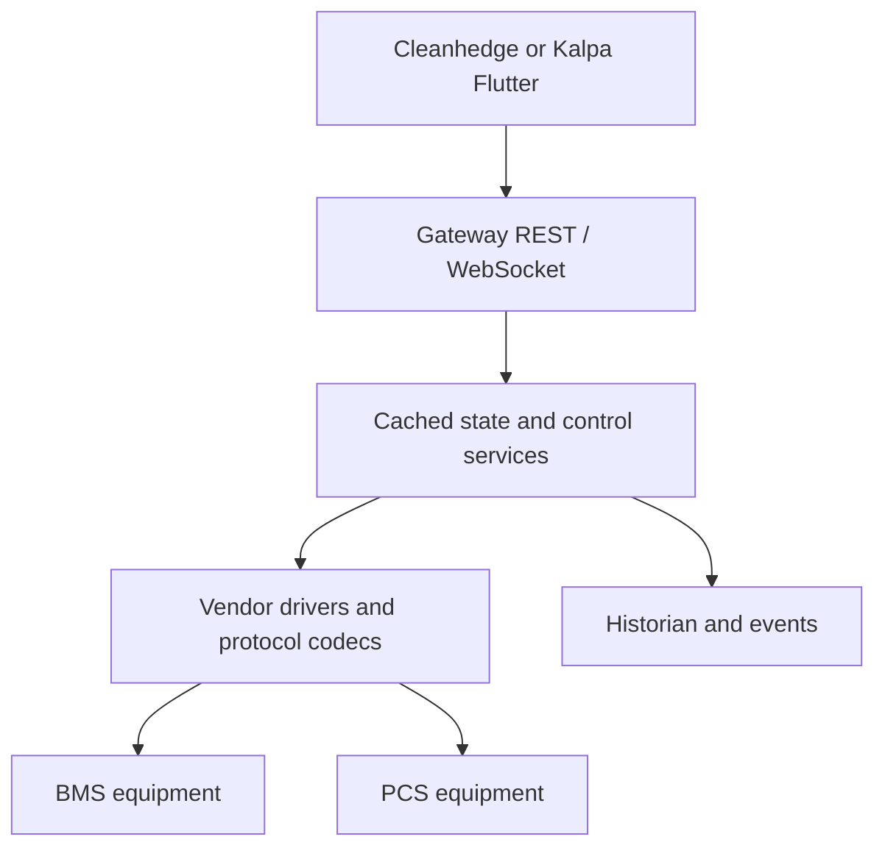
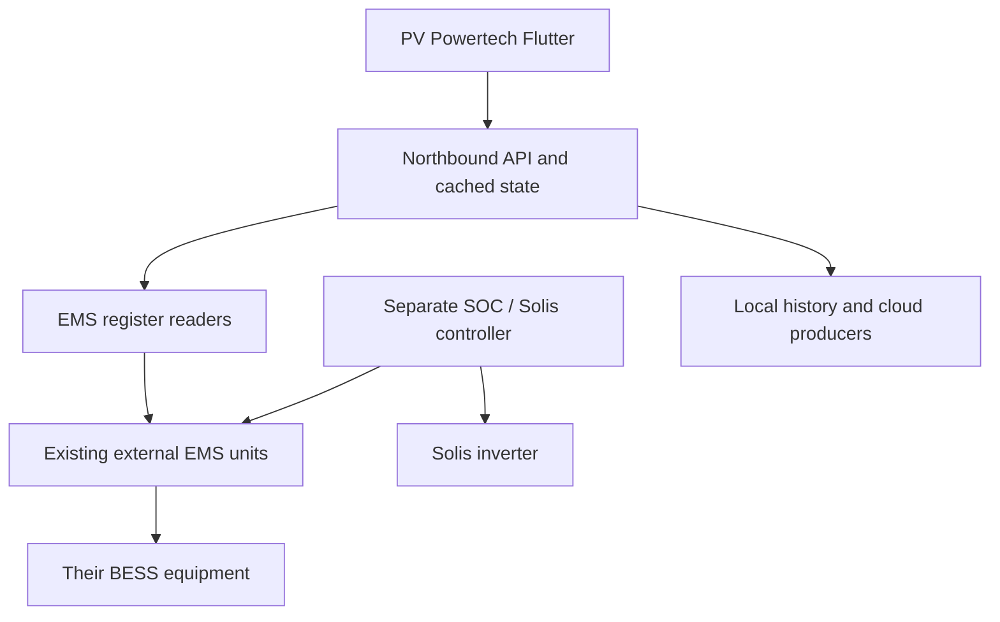
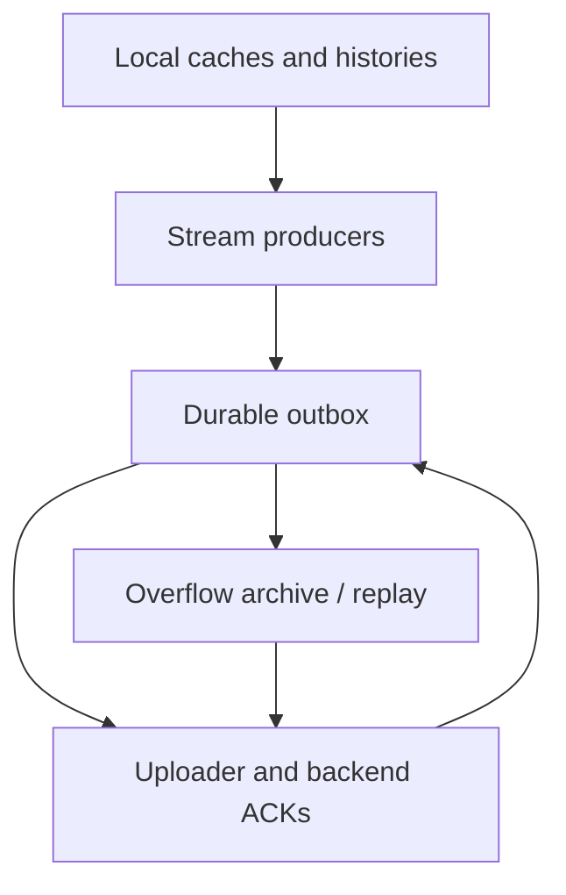

# Ornate EMS Repository — Architecture and Knowledge Transfer

**Prepared for:** engineering handover from Kunal Gupta to the Ornate Solar team  
**Review date:** 8 November 2026, India time  
**Source:** `kinetics-grid-ems-main (1).zip` supplied for this review  
**Scope:** repository orientation, project pairing, architecture, programming concepts, module navigation and maintenance workflow.

## How to use this README

Place this file at the root of the extracted `kinetics-grid-ems-main` repository. Paths below are relative to that root unless marked as gateway runtime paths. This is a cross-project handover guide: start with the project map before entering an individual backend or Flutter folder.

Read sections 1–5 first to understand the products and ownership boundaries. Use sections 6–13 for implementation and operations. The appendices provide source-derived API and module indexes for deeper code reading.

This guide describes the supplied source snapshot. It does not certify that this exact snapshot is installed on any gateway. No production board, BESS, cloud backend or Flutter executable was tested during this documentation review. Existing validation reports are historical evidence and must be associated with their specific release.

## Contents

1. What this repository contains
2. Gateway and Flutter pairing
3. Kinetics versus Northbound: the architectural distinction
4. Cleanhedge direct-device gateway
5. Kalpa Ornate EMS platform
6. PV Powertech Northbound gateway
7. Flutter applications and frontend architecture
8. Networking, setup, remote access and startup
9. Programming concepts used in this code
10. Data, historian, alarms and cloud synchronization
11. Configuration and deployment workflow
12. Troubleshooting and engineering changes
13. Knowledge-transfer sequence and open handover items
14. Source-derived API inventory
15. Backend module and important-symbol inventory
16. Frontend source inventory and evidence notes

## 1. What this repository contains

The repository is an umbrella collection of multiple application projects and captured Linux deployment trees. It is not one Python package and does not have one command that launches everything.

Some folders contain files laid out as `/etc`, `/opt`, `/root`, `/usr` and `/var` because they are gateway filesystem exports. These names describe their original board locations. They are not instructions to copy the complete export over a development PC or a different gateway.

| Root folder | Purpose | Read first |
| --- | --- | --- |
| `kinetics_gateway_codebase_Cleanhedge/` | Direct BMS/PCS gateway snapshot for Cleanhedge | `opt/kinetics-gateway/backend/app/main.py`, captured gateway service and configuration |
| `kinetics_flutter_dashboard_Cleanhedge/` | Cleanhedge operator desktop dashboard | `README_FIRST.md`, `lib/core/state/gateway_controller.dart` |
| `kinetics_gateway_codebase_Kalpa/` | Kinetics-derived Ornate EMS platform, extended for Lineage BMS, Elecod PCS and ACREL metering | `opt/ornate-ems-gateway/backend/README_FIRST.md`, `docs/` |
| `kinetics_flutter_codebase_Kalpa/` | Kalpa operator dashboard; actual Flutter project is nested one level deeper | `kalpa_flutter_dashboard_v0.1/README.md` |
| `northbound_ems_gateway_PV_Powertech/` | Northbound gateway for existing external EMS units, plus supporting control and integration services | `root/kinetics-grid-ems/northbound_ems_gateway/src/nb_ems_gateway/main.py` |
| `northbound_ems_gateway_flutter_PV_Powertech/` | PV Powertech Northbound dashboard, SOC/Solis views and historian | `lib/core/api/northbound_api_client.dart`, `lib/features/dashboard/` |
| `Kinetics_Gateway_wifi_network_configuration_code/` | Separate wired-access setup agent for gateway Wi-Fi and diagnostics | `agent.py`, `kalpa-setup.service` |
| `Kinetics_Gateway_wifi_network_configuration_flutter/` | Desktop setup client for that agent | `lib/main.dart` |
| `Boot and Networking files/` | PV Powertech boot/network exports and a portable deployment bundle | `PV Powertech/ems_v3_deploy_bundle_portable/README.md` |
| `ems-gateway-tunnel/` | Cloudflare tunnel configuration and installer | `README.md`, `install_on_imx93.sh` |
| `flutter_dashboard/` | General dashboard with REST, separate log API, TCP command and UDP telemetry integration | `lib/core/config/network_config.dart`, `lib/core/api/endpoint_paths.dart` |

### Source snapshots versus reusable product code

Cleanhedge and Kalpa share architectural ancestry, but they are separate copies with different capabilities. A change in one does not automatically update the other. For example, Cleanhedge contains a priority I/O arbiter and command-reliability modules that are absent from the corresponding Kalpa protocol folder in this archive. Kalpa contains vendor-neutral control, normalized views and Central Sync modules absent from Cleanhedge's application folder.

Staging trees, old backup configurations and patch notes are useful evidence. They are not automatically the active version. Start from the current-looking application path and captured service, then verify the effective unit, drop-ins and config on the actual gateway.

## 2. Gateway and Flutter pairing

| Project/site | Gateway source root inside repository | Flutter project root | Pairing basis |
| --- | --- | --- | --- |
| Cleanhedge / Kinetics | `kinetics_gateway_codebase_Cleanhedge/opt/kinetics-gateway/backend/` | `kinetics_flutter_dashboard_Cleanhedge/` | Dashboard README explicitly pairs with Kinetics gateway V3.0.2; shared REST/control vocabulary |
| Kalpa / Ornate EMS platform | `kinetics_gateway_codebase_Kalpa/opt/ornate-ems-gateway/backend/` | `kinetics_flutter_codebase_Kalpa/kalpa_flutter_dashboard_v0.1/` | Kalpa README names the backend; Lineage/Elecod catalogs, normalized monitoring and meter support match |
| PV Powertech / Northbound | `northbound_ems_gateway_PV_Powertech/root/kinetics-grid-ems/northbound_ems_gateway/` | `northbound_ems_gateway_flutter_PV_Powertech/` | Matching source, asset, controller, Solis and Fast BESS API calls |
| Wired Wi-Fi commissioning | `Kinetics_Gateway_wifi_network_configuration_code/` | `Kinetics_Gateway_wifi_network_configuration_flutter/` | Both use the setup agent's `/v1/` contract on port 8765 |
| General Flutter dashboard | Matching backend is not established by this archive | `flutter_dashboard/` | Client expects REST 8000, logs 7000, TCP 6000 and UDP 5005; confirm matching server implementation before deployment |

**Do not interchange dashboards only because they open the same IP and port.** Authentication, response envelopes, point IDs, source namespaces, command bodies and historian formats are part of the pairing. Shared endpoint names alone do not prove compatibility.

There are also two different meanings of “pair”:

- **Software pair:** one backend project and its Flutter application.
- **BESS control pair:** one configured BMS rack and one PCS controlled together. Four software-configured BESS pairs do not prove four physical pairs were commissioned.

## 3. Kinetics versus Northbound: the architectural distinction

| Question | Direct-device family: Cleanhedge / Kalpa | PV Powertech Northbound |
| --- | --- | --- |
| What does the gateway normally connect to? | BMS and PCS equipment through vendor-specific interfaces; additional solar/meter support varies by project | Existing external EMS units through their exposed Modbus map; Solis has a separate controller path |
| Who interprets vendor device registers? | Local BMS/PCS drivers, catalogs and adapters | Northbound register dictionary and reader interpret the external EMS interface |
| What is a source identity? | Device/rack/PCS identity and configured BMS–PCS pair | External EMS identity, with assets namespaced beneath it |
| Main Python package | `app` | `nb_ems_gateway` under `src/` |
| Startup | Uvicorn imports `app.main:app` | Module entry constructs dependencies, scheduler, readers, services and API |
| Control responsibility | Pair-level BMS/PCS sequencing and vendor-specific verification | External EMS command abstraction, plus separate SOC/Solis process |
| Cloud transport in supplied app tree | Kalpa has Central Sync; Cleanhedge app tree does not | Central Sync, generic server upload and UGX integrations exist as distinct implementations |
| UI | Matching Cleanhedge or Kalpa Flutter app | Matching PV Powertech Flutter app |

### Direct-device flow



### Northbound flow



These diagrams show software responsibility, not electrical wiring. In particular, “Northbound” here is the name of an application family. It does not mean that every cloud-related module belongs exclusively to that family: Kalpa also has Central Sync.

## 4. Cleanhedge direct-device gateway

### 4.1 Runtime locations and startup

| Item | Captured runtime location / value |
| --- | --- |
| Backend | `/opt/kinetics-gateway/backend` |
| Python environment | `/opt/kinetics-gateway/venv` |
| Main service | `kinetics-gateway.service` |
| Configuration | `/etc/kinetics-gateway/config.json` through `KINETICS_CONFIG` |
| Environment file | `/etc/kinetics-gateway/kinetics-gateway.env` |
| API startup | `uvicorn app.main:app --host 0.0.0.0 --port 8000` |

Evidence: `kinetics_gateway_codebase_Cleanhedge/etc/systemd/system/kinetics-gateway.service`.

`app/main.py` loads configuration, creates the SQLite store, authentication service, runtime metrics and HTTP admission controller, then constructs `GatewayService` without eager hardware initialization. A lifespan supervisor warms the hardware caches in a worker thread and starts independent polling tasks. This allows API startup to be separated from slower hardware initialization.

The BMS classes are `fast`, `normal`, `slow` and `bulk`; PCS and solar have their own tasks when enabled. `periodic_loop()` uses a monotonic clock and `asyncio.to_thread()` around synchronous work. Long polls are measured and missed timing is recorded rather than creating unlimited catch-up work. Shutdown cancels tasks and closes owned resources unless the special skip-close environment setting is used.

### 4.2 Major modules

| Module under backend | Responsibility | Typical reason to edit |
| --- | --- | --- |
| `app/core/config.py` | Configuration models, defaults, loading and path resolution | New validated setting or deployment option |
| `app/core/catalog.py` | Protocol metadata and PCS overrides | New point metadata or catalog handling |
| `app/assets/bms_driver.py` | BMS communication and rack/system interpretation | BMS read/write or addressing problem |
| `app/assets/pcs_driver.py` | PCS communication and command primitives | PCS map, RTU behavior or readback |
| `app/assets/solar_driver.py` | Solar integration | Solar measurement/control support |
| `app/protocols/codec.py` | Raw-register encoding/decoding | Signedness, word order or scaling issue |
| `app/protocols/planner.py` | Read-block planning | Poll efficiency or invalid block boundaries |
| `app/protocols/modbus_tcp.py` | Modbus TCP transport | Connections, timeouts and TCP transaction behavior |
| `app/protocols/modbus_rtu.py` | Serial Modbus transport | Serial configuration, response framing or bus contention |
| `app/protocols/io_arbiter.py` | Priority admission to an I/O lane | Control latency versus telemetry competition |
| `app/protocols/command_reliability.py` | Command outcome handling | Ambiguous result after a transport failure |
| `app/services/gateway_service.py` | Cached plant state, poll integration, snapshots, historian preparation and public service methods | Data available to APIs/UI or cache performance |
| `app/services/bms_pcs_control.py` | Pair control sequence, monitoring and control policy | Start/stop, ramp, pair interlocks or abort behavior |
| `app/services/http_admission.py` | Bounded HTTP concurrency with priority capacity | API overload or control-request starvation |
| `app/services/historian_admission.py` | Historian workload admission | Expensive history requests competing with live work |
| `app/services/runtime_metrics.py` | Runtime timing and workload measurements | Diagnose latency, missed polls or concurrency |
| `app/services/alarm_engine.py` | Alarm interpretation/lifecycle | Alarm transitions and operator display |
| `app/storage/sqlite_store.py` | SQLite, storage-root selection, retention and export support | History, disk use or database behavior |
| `app/api/routes.py` | HTTP and WebSocket interface | Add/change a public operation |
| `app/security/auth.py` | Authentication and permissions | Login or authorization policy |

### 4.3 State and data flow

A poll reads a selected set of points through the appropriate driver. The driver uses the catalog and codec to produce interpreted values. `GatewayService` merges them into the cached plant state, updates relevant derived data and alarms, and prepares history samples according to storage policy. APIs and the dashboard consume views of that state.

Important distinctions in `GatewayService`:

- `snapshot()` exposes a broader plant view.
- `compact_snapshot()` produces a smaller transfer representation.
- `scheduler_control_view()` provides a focused control-consumer view.
- `control_pair_snapshot()` supplies a pair-oriented cached view.
- `updates_since()` supports incremental updates.
- `rack_details()` and `pcs_details()` address asset detail use cases.
- `close()` releases the resources the service owns.

Do not replace small control/status reads with full bulk snapshots without considering copy cost, lock hold time and fieldbus traffic. A compact payload is about transfer size; it does not by itself establish how fresh the underlying data is.

### 4.4 Captured configuration observations

The captured `/etc/kinetics-gateway/config.json` uses `mode=control_enabled`, enables BMS/PCS writes, lists four PCS devices on RTU and uses a three-level BMS architecture. Its PCS `commissioning_status` text still describes PCS1 read-only validation and PCS2–PCS4 pending IDs. This is an internal inconsistency to reconcile with commissioning records; the enabled device list is not proof of validated wiring.

Captured polling intervals are BMS fast 1 s, normal 5 s, slow 60 s, bulk 30 s, and PCS 5 s. These are values from this configuration, not universal project constants or timing guarantees. Always check the installed config before quoting them.

The archive contains scheduler units including `bess-seven-day-v302.service` and other BESS scheduling variants. Determine which unit actually owns scheduling on the target. Do not enable all similarly named units.

## 5. Kalpa Ornate EMS platform

### 5.1 Relationship to Kinetics

Kalpa retains the Kinetics application structure and legacy controller while adding a vendor abstraction for Lineage BMS and Elecod PCS. It is a complete application tree under `/opt/ornate-ems-gateway/backend`, rather than a patch to paste over Cleanhedge.

The README describes four configurable PCS–rack pairs, dynamic Lineage charge/discharge limits, staged control, ramp tracking, runtime monitoring, abort and safe-stop behavior. These are implementation/release claims; hardware readiness must be established independently.

### 5.2 Runtime and readiness

| Item | Captured value |
| --- | --- |
| Main service | `ornate-ems-gateway.service` |
| Backend | `/opt/ornate-ems-gateway/backend` |
| Python environment | `/opt/ornate-ems-gateway/venv` |
| Config | `/etc/ornate-ems-gateway/config.json` through `ORNATE_EMS_CONFIG` |
| Compatibility fallback | `KINETICS_CONFIG` is also accepted by `app/main.py` |
| Captured bind | `127.0.0.1:8000` |
| Captured mode | `mock` |
| BMS / PCS vendor | `lineage` / `elecod` |
| Captured writes | Disabled for BMS and PCS |

The configuration contains example addresses in `192.0.2.0/24` and explicit software-in-loop commissioning labels. Treat these as template/simulation values. The captured PCS power-sign flag is true, while other validation flags remain false; this is not sufficient to declare field control commissioned.

The Kalpa Flutter README describes direct LAN operation and an optional helper to change the bind to `0.0.0.0`. The captured unit still uses loopback. A working remote tunnel and working direct LAN connection are different tests; verify the effective installed listener and any service override.

### 5.3 Kalpa-specific modules

| Module under backend | Role |
| --- | --- |
| `app/assets/lineage_adapter.py` | Lineage-specific interpretation/control adapter |
| `app/assets/elecod_adapter.py` | Elecod-specific interpretation/control adapter |
| `app/assets/normalized.py` | Common asset representations |
| `app/assets/mock_control_drivers.py` | Simulated control drivers for software-in-loop work |
| `app/services/control_factory.py` | Selects the controller for the configured vendor combination |
| `app/services/vendor_neutral_control.py` | Adapter-driven pair control for the new vendor combination |
| `app/services/normalized_views.py` | Normalizes system/rack/PCS/safety values for consumers |
| `app/services/platform_readiness.py` | Platform/commissioning readiness support |
| `app/assets/acrel_meter.py` | ACREL meter integration |
| `app/core/acrel_config.py` | Meter configuration support |
| `app/local_hmi/router.py` | Local browser HMI routes |
| `app/central_sync/` | Cloud producer, outbox, upload, recovery and command-downlink implementation |

`build_pair_control_service()` in `control_factory.py` is the key selection point. Its documented intent is to keep the Kinetics vendor combination on the legacy controller and use `VendorNeutralPairControlService` for Lineage + Elecod. In mock mode it can substitute mock control drivers. This is where a future vendor combination should be considered before changing every public route.

Normalization must preserve provenance. For example, `lineage_safety_view()` explicitly describes some fire/safety data as BMS/BAMS summary inputs, not a complete standalone fire-controller protocol. A screen with a safety category must not imply a more complete equipment interface than the source supplies.

### 5.4 Protocol catalogs and dashboard behavior

Kalpa uses generated Lineage and Elecod protocol catalogs. The Flutter project has a generated display catalog to restore descriptions, units, register addresses and categories when compact telemetry omits metadata. The README states that backend engineering values are displayed without reapplying Kinetics scaling or reinterpreting FLOAT32 values.

For Lineage, positive current is presented as charging in the Kalpa UI documentation. Do not carry that convention over to another vendor or use it as a universal PCS power-sign rule. Invalid/offline readings should remain distinguishable from valid numerical zero.

An explicit “Load complete rack data” operation retrieves bulk data through an existing detail API. It is different from continuously enabling additional live polling. The separate Wi-Fi setup application is not merged into this operator dashboard.

### 5.5 Starting points for Kalpa handover

Read `README_FIRST.md`, then `docs/ARCHITECTURE_FREEZE_V2.md`, `docs/PHASE5_VENDOR_NEUTRAL_CONTROL.md`, `docs/PHASE6_SOFTWARE_COMPLETE_RC.md` and `docs/FIELD_VALIDATION_GATES.md` under the backend. Review `configs/elecod_lineage_4pair_sil.json` for simulation, the phase4 read-only template for initial field reads, and the control-ready template for the gated control configuration.

The presence of code, SIL fixtures, Windows runner files or validation reports does not establish a completed physical BESS commissioning or a rebuilt native executable.

## 6. PV Powertech Northbound gateway

### 6.1 What this project does

This application obtains data from existing external EMS units. It uses an EMS register map to expose assets such as PCS, BMS, cooling, fire, utility meter and EMS system information to higher-level consumers. Separate source IDs distinguish otherwise similar assets from different EMS units.

The captured development config lists `external_ems_1` and `external_ems_2`, both Modbus TCP with unit ID 1. It uses port 502 in this snapshot. Other site deployments may use different ports or addresses; historical values must not override the selected current config.

### 6.2 Package layout and startup

The application root inside the snapshot is:

```text
northbound_ems_gateway_PV_Powertech/root/kinetics-grid-ems/northbound_ems_gateway/
```

Its Python package is `src/nb_ems_gateway/`. `main.py` performs the composition:

1. Parse `--config`, `--mock` and `--no-api`.
2. Load configuration and register dictionary.
3. Build a `DependencyContainer` containing shared state and services.
4. Create one reader per active external source.
5. Construct control, SOC protection, Fast BESS logger and general-asset publisher components.
6. Construct/start the scheduler and associated services; serve the API through the constructed app.

Read the full `amain()` lifecycle when changing startup or shutdown. Importing a class successfully does not mean its service has been started.

### 6.3 Major modules

| Module relative to application root | Responsibility |
| --- | --- |
| `src/nb_ems_gateway/config/models.py`, `loader.py` | Validated settings and loading |
| `src/nb_ems_gateway/dictionary/register_map.py` | EMS register-point definitions and map loading |
| `src/nb_ems_gateway/decoding/float_codec.py` | Float register encoding/decoding |
| `src/nb_ems_gateway/protocol/reader.py` | Mock and hardware Modbus readers; compatibility across pymodbus call signatures |
| `src/nb_ems_gateway/polling/scheduler.py` | Multi-source polling lifecycle |
| `src/nb_ems_gateway/sources/namespacing.py` | Prevent cross-EMS point/asset identity collisions |
| `src/nb_ems_gateway/app/dependency_container.py` | Constructs and holds shared application dependencies |
| `src/nb_ems_gateway/assets/asset_manager.py` | Asset organization and cached information |
| `src/nb_ems_gateway/assets/general_asset_live_publisher.py` | General-asset live snapshot production |
| `src/nb_ems_gateway/control/control_service.py` | External EMS command operations |
| `src/nb_ems_gateway/control/soc_protection.py` | Gateway SOC protection component |
| `src/nb_ems_gateway/operator_control/` | Operator status/history/settings storage and support |
| `src/nb_ems_gateway/storage/fast_bess_logger.py` | Fast BESS historian implementation |
| `src/nb_ems_gateway/storage/sqlite_store.py` | General storage implementation |
| `src/nb_ems_gateway/alarms/alarm_engine.py` | Alarm interpretation/lifecycle |
| `src/nb_ems_gateway/health/health_engine.py` | Health views |
| `src/nb_ems_gateway/api/server.py` | FastAPI application and router assembly |
| `src/nb_ems_gateway/api/routes_*.py` | Separate endpoint families |
| `src/nb_ems_gateway/central_sync/` | Durable cloud synchronization and related stream producers |
| `src/nb_ems_gateway/server_upload/` | Separate generic upload implementation |
| `src/nb_ems_gateway/ugx_uploader/` | UGX-specific adapters and upload implementation |
| `tools/soc_only_controller.py` | Separate field SOC/Solis controller executable |
| `edge_ai_poc/` | Edge AI proof-of-concept files |

### 6.4 Why namespacing matters

Both EMS units may expose an asset called `pcs` and the same register address. A point must retain the source identity as well as its local identity. Otherwise one EMS can overwrite another in a cache, historian, dashboard or cloud payload. For example, the captured Fast BESS config maps source IDs to distinct asset IDs such as `external_ems_1_pcs` and `external_ems_2_pcs`.

When adding a third source, inspect the source config, namespacing, asset mapping, historian profile, UI source filter and cloud identity together. Changing only the IP list is insufficient.

### 6.5 Separate SOC/Solis controller

The captured `ems-v3-soc-controller.service` launches `tools/soc_only_controller.py --config configs/soc_solis_field_rtu.json --live` as its own process. The main gateway also has a `SOCProtectionController` component. These are distinct implementations with different lifecycle/ownership; do not assume the similarly named component replaces the field tool.

The field tool reads EMS SOC, decides a state/action plan, issues configured EMS and Solis operations and persists operator-visible state/history. Functions such as `decide_states()`, `build_action_plan()`, `command_bess()`, `command_solis()` and `persist_operator_cycle()` are useful reading landmarks.

The tool's header describes upper-SOC shutdown, optional lower-SOC protection/recovery and a derating strategy. It records a field-specific Solis register 3051 scaling convention. This is release/site evidence, not a generic register prescription for all inverters. Read configuration and the vendor model before altering command behavior.

The matching Flutter application reads controller status/history/settings and exposes threshold editing only to the intended internal role. An application button should not be treated as the sole enforcement boundary: review backend authorization and physical command gates as well.

### 6.6 Captured service graph

| Captured unit | Role / handover concern |
| --- | --- |
| `ems-v3-gateway.service` | Starts the full gateway through `ems_network_bootup/nb_ems_gateway_start.sh` |
| `ems-v3-soc-controller.service` | Runs the separate live SOC/Solis controller |
| `ems-v3-eth1.service`, `ems-v3-wifi.service` | Field network setup |
| `ems-v3-solis-link.service` | Solis connectivity setup |
| `central-sync.service` | Separate store-and-forward service; requires `/mnt/ems-logs` |
| `central-sync-backlog-replay.service` | Backlog replay support |
| `northbound-ugx-cloud-uploader.service` | Separate UGX upload path |
| `edge-ai-live-infer.service`, `edge-ai-api.service`, `edge-ai-ugx-uploader.service` | Edge AI runtime/API/upload services |
| `nb-ems-gateway.service`, `nb-ems-soc-controller.service`, `nb-ems-soc-solis-controller.service` | Additional service definitions retained in the snapshot; verify whether used |

A unit file existing under `/etc/systemd/system` does not prove it is enabled or running. The effective `ExecStart`, config path, mount and environment determine the behavior.

### 6.7 Important completeness and version findings

- `configs/development.json` references `data/register_maps/unity261pv_modbus_north_v1.json`. That file is absent at the expected application-relative path in this archive.
- It also references a Fast BESS profile and a Central Sync policy manifest beneath `data/`. These runtime inputs must be resolved before claiming a clean reproduction of the configured application.
- The captured general storage config has `enabled=false` and `telemetry_history_enabled=false`, while the Fast BESS logger has `enabled=true`. Therefore “general history disabled” is not equivalent to “nothing is logged.”
- The captured `configs/central_sync.json` has `enabled=true`. This differs from earlier project baselines where it was disabled. The supplied snapshot is the evidence for this README; actual running state remains unverified.
- The application-root README is an S2 bounded-message patch note labelled offline-tested/not for field deployment. It does not explain the entire gateway. `main.py` and service/config evidence must also be read.
- Version strings, patch README titles and captured service files belong to different development stages. Establish the approved production release explicitly instead of inferring it from the largest version number.

## 7. Flutter applications and frontend architecture

### 7.1 What Flutter is responsible for

Flutter/Dart supplies the operator interface: connection selection, login, views, filtering, history requests and command submission. The backend owns Modbus, authoritative engineering-value interpretation, storage, control sequences and server-side checks. A running Windows dashboard is a client of the gateway, not the gateway itself.

Changing Flutter source does not update an already built `.exe`. Rebuild and distribute the release bundle. For Kalpa, the README specifically instructs distributing the complete Windows Release folder, including required DLLs and data.

### 7.2 Cleanhedge frontend

Start with `lib/main.dart`, `lib/core/api/gateway_api_client.dart`, `lib/core/state/gateway_controller.dart` and `lib/screens/home_shell.dart`. Screens cover dashboard, racks, PCS, environment, solar, alarms, historian, diagnostics and control sequences.

The API client uses `dart:io` HTTP, configures a base URL and attaches a bearer token. Its long timeout defaults should be understood before diagnosing a slow screen: a timeout setting is not proof that the backend should take that long. Inspect request timing and server load.

The README describes cache-only multi-pair control polling, an explicit selected-pair live refresh, a controlled ramp for automatic start and direct target submission for Set power after gateway checks. Preserve the distinction between background status refresh and explicit field operations.

### 7.3 Kalpa frontend

The actual project root is `kinetics_flutter_codebase_Kalpa/kalpa_flutter_dashboard_v0.1/`, where `pubspec.yaml` lives. Opening only the outer folder can lead to build commands being run in the wrong directory.

Important files include `kalpa_monitoring_screen.dart`, `kalpa_asset_detail_screen.dart`, `kalpa_asset_presentation.dart`, `kalpa_signal_catalog.dart` and `meter_screen.dart`, alongside the retained Kinetics-style controller/API layers. Legacy screen files remain; trace active navigation before editing a screen simply because its name looks relevant.

The Kalpa README states Windows is the primary target, Android packaging is unverified and web is unsupported by the `dart:io` transport. Platform runner directories alone are not evidence of supported releases.

### 7.4 Northbound frontend

Read `lib/core/api/northbound_api_client.dart`, `lib/core/config/app_connection_config.dart`, `lib/features/auth/`, and `lib/features/dashboard/`.

The API client exposes source summaries, asset telemetry, key signals, alarms, Fast BESS history/profile/status, controller status/history/settings and Solis status/history. Source selection matters because similar equipment exists beneath multiple external EMS identities.

The dashboard has page-building/aggregation helpers for PCS, BMS, cooling, utility meter, fire and EMS system views. This separates some presentation construction from transport. Historian pagination and persistent navigation notes explain previous performance work; read these before replacing the history fetch pattern with an unbounded query.

### 7.5 General `flutter_dashboard/`

This project has a more explicit API/repository/model layering: `lib/core/api/`, `lib/repositories/`, `lib/models/`, `lib/features/` and reusable widgets. `NetworkConfig.hardware()` defaults to REST 8000, logs 7000, TCP commands 6000 and UDP telemetry 5005.

The README is boilerplate. Neither the name nor partial overlap in REST paths proves that it is the current Cleanhedge/Kalpa/Northbound UI. Record its intended backend and deployment status with the project owner before assigning it as a maintained site application.

## 8. Networking, setup, remote access and startup

### 8.1 Communication layers

| Link | Purpose | Where to inspect |
| --- | --- | --- |
| Modbus TCP | Field register read/write over IP | Direct-device transport modules or Northbound `protocol/reader.py` |
| Modbus RTU / RS-485 | Field register transactions over serial | PCS transport config, `modbus_rtu.py`; Solis tool has its own implementation |
| REST / HTTP | Login, snapshots, history, settings and commands | Backend routes and matching Dart API client |
| WebSocket | Streaming/incremental telemetry | Backend WebSocket handlers and matching Flutter subscriptions |
| Cloudflare tunnel | Remote ingress to local services | Captured `cloudflared.service`, tunnel configuration and installation files |
| Wired setup API | Wi-Fi setup/diagnostics | Setup agent and setup Flutter client, port 8765 |
| TCP/UDP legacy-style client links | General dashboard command/telemetry paths | `flutter_dashboard/lib/core/network/` and config |

Do not assume port 502 for every device, port 8000 for every service or the same Ethernet address across sites. The effective config, route table and listener are the evidence.

### 8.2 Wi-Fi commissioning application

The setup backend is a separate Python HTTP server using `ThreadingHTTPServer`, a setup token and a small `/v1/` API. It operates Wi-Fi tooling such as `wpa_cli`, network diagnostics and service reconnection. The Flutter client connects directly to the selected wired gateway IPv4 address on port 8765.

| Endpoint | Purpose |
| --- | --- |
| `GET /v1/status` | Current Wi-Fi and pending operation |
| `GET /v1/wifi/scan` | Available networks |
| `POST /v1/wifi/apply` | Stage a Wi-Fi change and create an operation |
| `POST /v1/wifi/confirm` | Confirm the successfully established selected network |
| `GET /v1/connectivity` | Connectivity diagnostics |

`Manager.apply()` saves a pending backup and starts a worker. The operation must be confirmed before its deadline; otherwise it rolls back. Startup detects an unconfirmed persisted backup and restores it. This protects the commissioning flow from an unconfirmed change or power loss. `confirm()` verifies association, an IPv4 address and the expected SSID before committing.

Despite the folder's Kinetics name, the inspected agent contains Kalpa/DEBIX service assumptions such as `debix-wifi.service`. Do not treat it as a universal FRDM network installer.

### 8.3 Boot/network exports

`Boot and Networking files/PV Powertech/` includes both a dated captured network tree and a portable bundle. Read the bundle README and compare its units/scripts with those in the Northbound gateway export. Keep network changes separate from changes to register interpretation or control strategy so faults can be isolated.

### 8.4 Credentials and remote-access handover

The archive includes tunnel credential/configuration material and environment files. This README deliberately does not reproduce secret contents. Transfer operational credentials through the team's approved account/access process and record ownership of the tunnel/DNS/services. A tunnel credential is different from a dashboard login, JWT signing secret, setup token or backend ingest credential.

## 9. Programming concepts used in this code

### 9.1 Python applications on embedded Linux

The documented gateway applications run in Linux user space. Their Python polling loops are not FreeRTOS tasks, and these trees do not establish that the EMS application runs on the i.MX93 Cortex-M core. Linux drivers expose interfaces such as Ethernet and serial device nodes; Python libraries use those interfaces.

| Concept | Meaning here | Example to read |
| --- | --- | --- |
| Module/package | Organizes importable Python code | `app.assets`, `nb_ems_gateway.protocol` |
| Class/object | Holds state and behavior for one responsibility | `GatewayService`, `SQLiteStore`, `PollingScheduler` |
| Function/method | A callable operation; methods belong to an object | `poll_pcs()`, `read_point()`, `decide_states()` |
| Configuration model | Validates and gives structure to JSON settings | `app/core/config.py`, Northbound `config/models.py` |
| Type hint | Documents expected values; not a universal runtime check | `dict[str, Any]`, `float | None`, protocol interfaces |
| Dataclass | Convenient structured record | I/O arbiter waiter and controller runtime records |
| Enum | A constrained set of named values | `IoPriority` |
| Protocol/interface | Defines expected behavior independently of implementation | Northbound `RegisterReader` |
| Factory | Chooses the correct implementation from settings | Kalpa `build_pair_control_service()` |
| Dependency injection | Passes shared dependencies instead of repeatedly constructing them | Northbound container and service constructors |
| Context manager | Pairs resource acquisition with cleanup | App lifespan, arbiter slot handling |
| Exception | Reports a failure that callers must interpret | Transport errors and command-outcome ambiguity |

### 9.2 Async tasks, worker threads and processes

`asyncio` lets one event loop coordinate tasks that yield while waiting. It does not make a blocking serial read nonblocking by itself. Cleanhedge/Kalpa use `asyncio.to_thread()` around synchronous polling work so that API/event-loop activity can continue.

A worker thread shares process memory. A second systemd service is a separate process with its own memory and lifecycle. For example, the Northbound gateway, field SOC tool and Central Sync service communicate through their designed APIs/files/storage rather than sharing a Python object simply because they run on the same board.

Locks protect mutable state shared by threads. A priority admission queue chooses which waiting request gets an I/O lane; it cannot interrupt a Modbus transaction already on the wire. Cleanhedge's arbiter priorities are SAFETY, CONTROL, VERIFICATION, TELEMETRY and HISTORIAN, with aging to reduce starvation. These are application scheduling rules, not CPU interrupt priorities.

### 9.3 RTOS analogy and its limits

| Familiar MCU/RTOS idea | Related Linux/Python idea | Difference that matters |
| --- | --- | --- |
| Periodic task | Polling coroutine/thread loop | Linux scheduling and blocking I/O add timing variation |
| Mutex | `threading.Lock` / `RLock` | Async and thread locks have different usage rules |
| Queue | Admission queue or durable outbox | An outbox persists across restart; a RAM queue may not |
| Task priority | Application I/O/HTTP priority admission | Does not set a hard real-time CPU deadline |
| Watchdog/restart | systemd restart policy | Restarting a process does not verify safe plant state |
| ISR-triggered work | OS/network/serial event handling | Python application code is not the hardware ISR |

Do not promise deterministic microsecond protection timing from these Python services. Their responsibility is supervisory communication and control as implemented; device protection and electrical safety belong to the actual equipment design.

### 9.4 Data types and register interpretation

| Type / representation | Use and common error |
| --- | --- |
| 16-bit register word | Raw Modbus unit; not automatically a signed engineering value |
| FLOAT32 across two words | Needs correct byte/word order; a wrong order can produce plausible but false values |
| Signed/unsigned integer | Wrong signedness can turn a negative current into a large positive value |
| Bitfield/status word | Decode individual documented bits; a nonzero word is not one universal alarm |
| Enum code | Map documented codes to states; preserve unknown values |
| `float` / `int` / `bool` | Engineering value, count/state or logical flag; avoid indiscriminate conversion |
| `None` / JSON `null` | Missing/unavailable value; must remain distinct from zero |
| Timestamp | Capture time of data/event; timezone and data age matter |
| JSON object/list | API and configuration representation; validate shape as well as presence |
| Asset ID / source ID / point key | Separate identity dimensions; do not merge them casually |

Function code and address are separate parts of the register identity. Holding-register and input-register reads are different operations even at the same numerical address. Device manuals may number addresses differently from the protocol offset used by the client; inspect offset configuration and the actual request.

### 9.5 Caches, snapshots and backpressure

A cache avoids repeatedly reading the same fieldbus point for every dashboard widget. A snapshot makes a coherent view available to consumers. It can still be old, so retain data age and quality. A delta contains changes since a sequence/version and needs a suitable initial state or recovery behavior.

Backpressure bounds how much work may be pending: HTTP admission limits concurrent requests, historian admission limits expensive queries, and outbox capacity constrains cloud backlog. Raising every timeout or queue size can hide overload while increasing memory, disk use and operator wait time. Diagnose poll duration, cache size, query cardinality and retry behavior together.

### 9.6 Dart and Flutter concepts

`Future` represents an asynchronous result; `await` suspends the current async flow. Widgets build the UI from state. `StatefulWidget` stores changing screen state, while controllers/repositories/API clients help keep transport and domain behavior out of rendering code.

JSON must be converted into the expected model or map shape before use. UI state should distinguish loading, valid zero, unavailable, stale and failed. Dispose timers/subscriptions/controllers where owned, and avoid starting duplicate refresh loops when navigating between screens. A cached navigation design can retain a screen without meaning that it should continue every expensive history fetch in the background.

## 10. Data, historian, alarms and cloud synchronization

### 10.1 Different data paths

| Data path | Purpose | Do not confuse with |
| --- | --- | --- |
| Live RAM cache | Current operational views | Durable history |
| Telemetry historian | Samples over time for trends/export | Every raw Modbus transaction |
| Alarm/event history | State transitions and operational events | Periodic numerical sample table |
| Application logs/journal | Diagnostics, failures and service lifecycle | A complete asset historian |
| Command audit | Requested action and result/evidence | Confirmation that requested electrical power occurred |
| Cloud outbox | Durable messages awaiting/retaining transport state | Permanent analytics database |
| Overflow/archive/replay | Recoverable backlog handling | A substitute for ACK processing |
| Runtime status files | Cross-process latest state | Full durable history unless explicitly implemented |

### 10.2 Direct-device storage

`SQLiteStore` selects a storage root, initializes tables, provides synchronization and retention/export behavior. The inspected Cleanhedge store checks whether the preferred mount is actually mounted and can use a fallback according to configuration. Therefore a path existing as an ordinary directory is not sufficient evidence that the SD-backed storage is in use.

Telemetry sample cadence, preferred/fallback retention and quota are configuration-dependent. Bulk live inclusion, poll cadence and historian sampling are different settings. To answer “are all values logged?”, inspect the selected sample/profile/filter logic and actual database contents; do not infer it from the presence of a live screen.

### 10.3 Northbound historian split

The supplied development configuration disables the general telemetry-history path but enables Fast BESS logging. Fast BESS has its own profile path, source mapping, interval and max-age settings. It is configured for a 1-second interval, 90-day retention and `value_only` write mode in this snapshot. These settings do not prove every asset point is sampled each second.

The matching Flutter historian uses Fast BESS API methods and pagination. Trace profile selection and source identity before changing charts or export columns.

### 10.4 Central Sync

Both Kalpa and Northbound have Central Sync implementations. Their module names overlap, but producer sets and source adapters differ. Do not copy a producer between projects without checking its source contract.

Conceptually, a producer obtains selected local data, constructs a logical message with identity/sequence, enqueues it durably, and an uploader submits batches to the backend. Acknowledgments determine transport progress. Retries require stable message identity and backend duplicate handling. Overflow and replay support handle backlog beyond the ordinary active path.



Northbound producers include gateway health, Fast BESS, general assets, alarms/events, SOC controller, Solis, Edge AI and configuration/audit. Command downlink code exists separately; presence of a module does not prove remote commands are commissioned or enabled.

The Northbound S2 patch README documents bounded logical-message splitting and distinguishes that from a hard HTTP request limit. It lists unresolved real-backend validation gates. Preserve this distinction when changing cadence or maximum bytes: smaller individual messages do not automatically guarantee all mixed batches meet a server's request cap.

Generic `server_upload`, `ugx_uploader` and Central Sync are separate paths. Decide which are intended for the deployment before starting upload services, otherwise similar data can be transmitted through multiple integrations.

### 10.5 Edge AI scope

Northbound includes an `edge_ai_poc` directory, API route and service definitions. This establishes an integrated proof-of-concept surface in the archive, not successful NPU inference, trained-model suitability or a production anomaly-detection guarantee. Hand over the model, feature order, scaler/preprocessing, training provenance, thresholds and CPU/NPU execution evidence separately before making those claims.

## 11. Configuration and deployment workflow

### 11.1 Establish what is actually running

On the intended board, use read-only checks first. Replace the unit below with the site-specific gateway unit from this guide:

```bash
systemctl status kinetics-gateway.service --no-pager
systemctl cat kinetics-gateway.service
systemctl show kinetics-gateway.service -p FragmentPath -p DropInPaths -p ExecStart -p EnvironmentFiles -p WorkingDirectory
journalctl -u kinetics-gateway.service -n 100 --no-pager
ss -lntp
ip -br addr
ip route
findmnt /mnt/ems-logs
df -h /mnt/ems-logs
```

For Northbound, also inspect `ems-v3-gateway.service`, `ems-v3-soc-controller.service` and `central-sync.service`. For Kalpa, inspect `ornate-ems-gateway.service`. Record whether services are enabled as a separate question from whether they are currently active.

Do not paste secret environment-file contents into shared reports. Record the location and responsible owner instead.

### 11.2 Offline development

Work in a fresh isolated checkout/extraction. Resolve missing runtime inputs, create a separate virtual environment and use mock/SIL configs. Installing at repository root does not install every nested project. Read the chosen backend's dependency files before installation.

**Dependency finding:** Cleanhedge's supplied `requirements.txt` contains `httpx2>=2.7,<3`; Kalpa uses `httpx>=0.27,<1`. This unusual Cleanhedge entry needs reconciliation against the actual deployed environment or intended dependency before presenting a clean install command as verified. No dependency was silently changed during this review.

Useful offline checks, from the selected direct-device backend root:

```bash
python3 -m pytest -q
```

For Kalpa, its README additionally provides:

```bash
python3 tools/run_elecod_lineage_sil.py
```

These commands are starting points from the project sources, not results from this documentation task. Review fixtures and paths before running any suite in a field environment. Do not import a hardware-mode application on the production board merely to inspect it.

For Northbound, recover the register map/profile/policy first, then use a dedicated mock configuration with isolated storage and upload disabled. The `--mock` flag replaces readers, but does not by itself prove every other integration or storage location is isolated.

### 11.3 Flutter development

Run commands inside the relevant directory containing `pubspec.yaml`:

```powershell
flutter pub get
flutter analyze
flutter test
flutter build windows --release
```

Use the project's build scripts when they encode additional checks. Run Kalpa's documented category contract checks after catalog changes. Verify the full release folder on the target Windows machine and record the matching backend release and API URL.

### 11.4 Controlled field update sequence

1. Record the installed source/release, config, unit/drop-ins, active controllers and data paths.
2. Preserve an application/config/service backup and a consistent database backup where required.
3. Reproduce and test the intended change offline with the correct project pair.
4. Review whether the change affects field writes, sequencing, network access, schema or cloud identity.
5. Use the established site maintenance procedure and deploy only the intended files/services.
6. Verify startup, read-only telemetry, quality/age, expected background services, history and UI behavior.
7. Perform physical control commissioning only under the site's approved operating procedure; record observations and rollback criteria.

Avoid treating restart as a neutral check while an external controller may own plant operation. A process restart changes software availability and may affect active supervision.

## 12. Troubleshooting and engineering changes

### 12.1 Symptom-to-layer guide

| Symptom | First investigation | Relevant code / evidence |
| --- | --- | --- |
| No ping to expected IP | Interface link, subnet, route and actual assigned address | `ip -br addr`, `ip route`, site network scripts |
| Ping works but API cannot connect | Listening address/port, unit status, tunnel origin | `ss -lntp`, effective service, journal |
| Local Kalpa HMI/tunnel works but laptop LAN API fails | Loopback versus all-interface bind | Captured Kalpa unit binds `127.0.0.1` |
| HTTP 401/403 | Login/token, role, backend policy and possible remote-access layer | Auth module, matching API client |
| HTTP 503 under dashboard load | Admission saturation or service error | HTTP admission and runtime metrics |
| Wrong magnitude or sign | Address/function, raw words, codec order, scale and vendor sign | Catalog, codec, driver and vendor protocol |
| All displayed values zero | Distinguish valid zero from unavailable/quality loss and wrong point selection | Driver result, cache quality, UI formatting |
| One EMS replaces another's readings | Namespace/source filter collision | Northbound namespacing and frontend source selection |
| Controls slow while bulk reads run | Bus admission, transaction timeout and poll size | Cleanhedge arbiter/transport metrics |
| Command times out | Outcome may be unknown; inspect verified status before repeating | Command-reliability/control code and audit |
| History empty while live values work | Logger enabled/profile, storage mount, source filter and query window | SQLite store, Fast BESS config, historian API |
| Cloud backlog grows | Reachability, credentials, backend ACKs, payload size and disk capacity | Central Sync status, uploader, outbox, archive |
| UI still shows old behavior after source update | Old binary or incomplete release-folder replacement | Flutter build output/version |
| Memory high | Heap versus page cache, snapshot copies, long queries and overlapping work | Runtime metrics, cgroup figures, storage behavior |

### 12.2 Add one telemetry point end to end

1. Confirm which family owns the physical source: direct BMS/PCS or external EMS.
2. Obtain the authoritative register definition: address convention, function, quantity, type, order, scale, unit and access mode.
3. Add/update the catalog or register map and relevant grouping/profile/poll class.
4. Verify decoded values against raw words or a known fixture, including zero and invalid-quality behavior.
5. Preserve identity and timestamp/quality in cache and public view.
6. Update matching UI metadata/category only where needed; avoid applying scale twice.
7. Decide whether historian and cloud policy include this point; live inclusion does not imply either.
8. Verify a representative read/response and update release notes/tests proportionately.

### 12.3 Add or change a command

Trace the complete path: Flutter intent, API authorization/body, service policy, selected pair/source, current state/freshness, vendor adapter/reader, write transaction, readback/state confirmation and audit/result presentation. A successful HTTP response or socket write alone is not proof that the equipment reached the requested operating state.

When a timeout occurs after a write may have been sent, repeating it blindly can duplicate an action. Preserve the implementation's distinction between failed, succeeded and uncertain outcomes. Retain existing ramp, interlock, stop and monitoring semantics unless the requested change explicitly revises them.

### 12.4 Change a vendor or hardware platform

For a vendor change, prefer adapting catalog/driver/normalization/control-factory boundaries instead of rewriting screens around raw registers. For a Linux board change, review Python/dependency compatibility, serial device names, permissions, BSP drivers, mount paths, networking and service paths. Python user-space portability does not establish that the new board's BSP exposes identical interfaces.

## 13. Knowledge-transfer sequence and open handover items

### 13.1 Recommended walkthrough

| Session | Demonstration | Expected teammate outcome |
| --- | --- | --- |
| 1 — Project orientation | Explain section 2 and trace both architecture diagrams | Chooses the correct backend/UI pair |
| 2 — Direct-device implementation | Trace one BMS point and one PCS point through catalog, driver, cache, API and screen | Can debug a wrong telemetry value |
| 3 — Control ownership | Walk a pair command and Northbound's separate SOC/Solis process without executing hardware writes | Knows which component owns each decision |
| 4 — Northbound identity/data | Trace two external EMS sources, namespacing and Fast BESS data | Can preserve source separation |
| 5 — Operations | Read effective units, selected configs, mounts, logs and listeners | Can diagnose startup/connectivity/history failures |
| 6 — Cloud and release | Explain outbox/ACK/replay, build a matching Flutter release and review rollback | Can maintain a reproducible release |

### 13.2 Handover register to complete

| Item | Current evidence / required completion |
| --- | --- |
| Approved production release per site | Not established by the archive; record exact source commit/hash and installed version |
| Cleanhedge physical BESS pairing | Config lists four devices but commissioning text conflicts; reconcile with field records |
| Kalpa commissioning state | Captured config is mock with hardware writes disabled; record actual field validation separately |
| Northbound runtime data | Recover register map, historian profiles, policy manifests and associated versions |
| General dashboard owner | Identify intended backend and whether this project is active, reference or retired |
| Effective service set | Identify enabled/active units, overrides and exclusive controller ownership |
| Gateway inventory | Record site, board, OS/BSP, hostname, interface role, IP plan and serial mapping |
| Protocol sources | Retain approved vendor sheets and address/sign/scaling validation records |
| Python dependencies | Reconcile Cleanhedge `httpx2` entry and preserve known working versions |
| Frontend releases | Record app bundle/version, supported platform and matching backend |
| Cloud integrations | Identify intended Central Sync/UGX/generic upload services and backend contract owner |
| Historical data/backlog | Record mount, retention, database/archive backup and recovery procedure |
| Edge AI | Hand over model/preprocessing/feature contract and actual CPU/NPU validation evidence |
| Access ownership | Transfer gateway, tunnel, DNS and backend account ownership through the team's access process |
| Remaining vendor questions | Maintain unresolved protocol/commissioning questions with responsible owner |

### 13.3 Completion criteria

The handover is operationally complete when the receiving engineer can identify the correct project pair, reproduce a documented offline run using complete inputs, trace a value and command through the code, inspect a site's actual service/config state, build the correct dashboard, locate/recover stored data and distinguish implemented behavior from outstanding field validation.

## 14. Source-derived API inventory

The following appendix is extracted statically from route decorators in the supplied files. It is a navigation aid, not a tested OpenAPI contract. Parameter validation, request bodies, response shapes, authorization and side effects must be read in the referenced handler and its service calls. WebSocket authentication may differ from HTTP authentication. Do not invoke write routes as a connectivity test.

### Cleanhedge routes

| Method | Path | Handler | Source |
| --- | --- | --- | --- |
| GET | `/api/alarms` | `alarms` | [api/routes.py:302](kinetics_gateway_codebase_Cleanhedge/opt/kinetics-gateway/backend/app/api/routes.py#L302) |
| GET | `/api/alarms/history` | `alarm_history` | [api/routes.py:307](kinetics_gateway_codebase_Cleanhedge/opt/kinetics-gateway/backend/app/api/routes.py#L307) |
| GET | `/api/assets` | `assets` | [api/routes.py:148](kinetics_gateway_codebase_Cleanhedge/opt/kinetics-gateway/backend/app/api/routes.py#L148) |
| POST | `/api/auth/login` | `login` | [api/routes.py:128](kinetics_gateway_codebase_Cleanhedge/opt/kinetics-gateway/backend/app/api/routes.py#L128) |
| GET | `/api/auth/me` | `me` | [api/routes.py:140](kinetics_gateway_codebase_Cleanhedge/opt/kinetics-gateway/backend/app/api/routes.py#L140) |
| GET | `/api/bms/bank` | `bms_bank` | [api/routes.py:233](kinetics_gateway_codebase_Cleanhedge/opt/kinetics-gateway/backend/app/api/routes.py#L233) |
| GET | `/api/bms/environment` | `bms_environment` | [api/routes.py:269](kinetics_gateway_codebase_Cleanhedge/opt/kinetics-gateway/backend/app/api/routes.py#L269) |
| GET | `/api/bms/environment/{asset_id}` | `bms_environment_asset` | [api/routes.py:273](kinetics_gateway_codebase_Cleanhedge/opt/kinetics-gateway/backend/app/api/routes.py#L273) |
| GET | `/api/bms/racks` | `bms_racks` | [api/routes.py:238](kinetics_gateway_codebase_Cleanhedge/opt/kinetics-gateway/backend/app/api/routes.py#L238) |
| GET | `/api/bms/racks/summary` | `bms_racks_summary` | [api/routes.py:246](kinetics_gateway_codebase_Cleanhedge/opt/kinetics-gateway/backend/app/api/routes.py#L246) |
| GET | `/api/bms/racks/{rack_id}` | `bms_rack` | [api/routes.py:250](kinetics_gateway_codebase_Cleanhedge/opt/kinetics-gateway/backend/app/api/routes.py#L250) |
| GET | `/api/bms/racks/{rack_id}/details` | `bms_rack_details` | [api/routes.py:262](kinetics_gateway_codebase_Cleanhedge/opt/kinetics-gateway/backend/app/api/routes.py#L262) |
| GET | `/api/commands/audit` | `command_audit` | [api/routes.py:346](kinetics_gateway_codebase_Cleanhedge/opt/kinetics-gateway/backend/app/api/routes.py#L346) |
| GET | `/api/control-sequence/capabilities` | `control_sequence_capabilities` | [api/routes.py:352](kinetics_gateway_codebase_Cleanhedge/opt/kinetics-gateway/backend/app/api/routes.py#L352) |
| GET | `/api/control-sequence/control-view` | `control_sequence_control_view` | [api/routes.py:368](kinetics_gateway_codebase_Cleanhedge/opt/kinetics-gateway/backend/app/api/routes.py#L368) |
| POST | `/api/control-sequence/safe-stop-all` | `control_sequence_safe_stop_all` | [api/routes.py:374](kinetics_gateway_codebase_Cleanhedge/opt/kinetics-gateway/backend/app/api/routes.py#L374) |
| GET | `/api/control-sequence/status/all` | `control_sequence_all_status` | [api/routes.py:356](kinetics_gateway_codebase_Cleanhedge/opt/kinetics-gateway/backend/app/api/routes.py#L356) |
| GET | `/api/control-sequence/status/all/compact` | `control_sequence_all_status_compact` | [api/routes.py:362](kinetics_gateway_codebase_Cleanhedge/opt/kinetics-gateway/backend/app/api/routes.py#L362) |
| POST | `/api/control-sequence/{pair_id}/abort` | `control_sequence_abort` | [api/routes.py:768](kinetics_gateway_codebase_Cleanhedge/opt/kinetics-gateway/backend/app/api/routes.py#L768) |
| POST | `/api/control-sequence/{pair_id}/automatic-start` | `control_sequence_automatic_start` | [api/routes.py:453](kinetics_gateway_codebase_Cleanhedge/opt/kinetics-gateway/backend/app/api/routes.py#L453) |
| POST | `/api/control-sequence/{pair_id}/configure-pcs` | `control_sequence_configure_pcs` | [api/routes.py:659](kinetics_gateway_codebase_Cleanhedge/opt/kinetics-gateway/backend/app/api/routes.py#L659) |
| POST | `/api/control-sequence/{pair_id}/enable-rack` | `control_sequence_enable_rack` | [api/routes.py:536](kinetics_gateway_codebase_Cleanhedge/opt/kinetics-gateway/backend/app/api/routes.py#L536) |
| POST | `/api/control-sequence/{pair_id}/next-step` | `control_sequence_next_step` | [api/routes.py:478](kinetics_gateway_codebase_Cleanhedge/opt/kinetics-gateway/backend/app/api/routes.py#L478) |
| POST | `/api/control-sequence/{pair_id}/precheck` | `control_sequence_precheck` | [api/routes.py:510](kinetics_gateway_codebase_Cleanhedge/opt/kinetics-gateway/backend/app/api/routes.py#L510) |
| POST | `/api/control-sequence/{pair_id}/prepare-pcs-standby` | `control_sequence_prepare_pcs_standby` | [api/routes.py:640](kinetics_gateway_codebase_Cleanhedge/opt/kinetics-gateway/backend/app/api/routes.py#L640) |
| POST | `/api/control-sequence/{pair_id}/recover-bms` | `control_sequence_recover_bms` | [api/routes.py:607](kinetics_gateway_codebase_Cleanhedge/opt/kinetics-gateway/backend/app/api/routes.py#L607) |
| POST | `/api/control-sequence/{pair_id}/safe-stop` | `control_sequence_safe_stop` | [api/routes.py:749](kinetics_gateway_codebase_Cleanhedge/opt/kinetics-gateway/backend/app/api/routes.py#L749) |
| POST | `/api/control-sequence/{pair_id}/set-power` | `control_sequence_set_power` | [api/routes.py:697](kinetics_gateway_codebase_Cleanhedge/opt/kinetics-gateway/backend/app/api/routes.py#L697) |
| POST | `/api/control-sequence/{pair_id}/start-insulation` | `control_sequence_start_insulation` | [api/routes.py:555](kinetics_gateway_codebase_Cleanhedge/opt/kinetics-gateway/backend/app/api/routes.py#L555) |
| POST | `/api/control-sequence/{pair_id}/start-pcs` | `control_sequence_start_pcs` | [api/routes.py:678](kinetics_gateway_codebase_Cleanhedge/opt/kinetics-gateway/backend/app/api/routes.py#L678) |
| POST | `/api/control-sequence/{pair_id}/start-precharge` | `control_sequence_start_precharge` | [api/routes.py:588](kinetics_gateway_codebase_Cleanhedge/opt/kinetics-gateway/backend/app/api/routes.py#L588) |
| GET | `/api/control-sequence/{pair_id}/status` | `control_sequence_status` | [api/routes.py:388](kinetics_gateway_codebase_Cleanhedge/opt/kinetics-gateway/backend/app/api/routes.py#L388) |
| GET | `/api/control-sequence/{pair_id}/status/compact` | `control_sequence_status_compact` | [api/routes.py:420](kinetics_gateway_codebase_Cleanhedge/opt/kinetics-gateway/backend/app/api/routes.py#L420) |
| GET | `/api/control-sequence/{pair_id}/verify-insulation` | `control_sequence_verify_insulation` | [api/routes.py:574](kinetics_gateway_codebase_Cleanhedge/opt/kinetics-gateway/backend/app/api/routes.py#L574) |
| GET | `/api/control-sequence/{pair_id}/verify-power` | `control_sequence_verify_power` | [api/routes.py:735](kinetics_gateway_codebase_Cleanhedge/opt/kinetics-gateway/backend/app/api/routes.py#L735) |
| GET | `/api/control-sequence/{pair_id}/verify-ready` | `control_sequence_verify_ready` | [api/routes.py:626](kinetics_gateway_codebase_Cleanhedge/opt/kinetics-gateway/backend/app/api/routes.py#L626) |
| POST | `/api/control-sequence/{pair_id}/zero-power` | `control_sequence_zero_power` | [api/routes.py:716](kinetics_gateway_codebase_Cleanhedge/opt/kinetics-gateway/backend/app/api/routes.py#L716) |
| GET | `/api/control/capabilities` | `control_capabilities` | [api/routes.py:790](kinetics_gateway_codebase_Cleanhedge/opt/kinetics-gateway/backend/app/api/routes.py#L790) |
| POST | `/api/control/{asset_id}/{point_key}` | `control` | [api/routes.py:816](kinetics_gateway_codebase_Cleanhedge/opt/kinetics-gateway/backend/app/api/routes.py#L816) |
| GET | `/api/diagnostics/control-refresh` | `diagnostics_control_refresh` | [api/routes.py:193](kinetics_gateway_codebase_Cleanhedge/opt/kinetics-gateway/backend/app/api/routes.py#L193) |
| GET | `/api/diagnostics/data-rate` | `diagnostics_data_rate` | [api/routes.py:179](kinetics_gateway_codebase_Cleanhedge/opt/kinetics-gateway/backend/app/api/routes.py#L179) |
| GET | `/api/diagnostics/polling` | `diagnostics_polling` | [api/routes.py:183](kinetics_gateway_codebase_Cleanhedge/opt/kinetics-gateway/backend/app/api/routes.py#L183) |
| GET | `/api/diagnostics/runtime` | `diagnostics_runtime` | [api/routes.py:187](kinetics_gateway_codebase_Cleanhedge/opt/kinetics-gateway/backend/app/api/routes.py#L187) |
| GET | `/api/diagnostics/runtime-monitor` | `diagnostics_runtime_monitor` | [api/routes.py:199](kinetics_gateway_codebase_Cleanhedge/opt/kinetics-gateway/backend/app/api/routes.py#L199) |
| GET | `/api/diagnostics/runtime-monitor/{pair_id}/sample` | `diagnostics_runtime_monitor_sample` | [api/routes.py:205](kinetics_gateway_codebase_Cleanhedge/opt/kinetics-gateway/backend/app/api/routes.py#L205) |
| GET | `/api/events` | `events` | [api/routes.py:316](kinetics_gateway_codebase_Cleanhedge/opt/kinetics-gateway/backend/app/api/routes.py#L316) |
| GET | `/api/export/alarms.csv` | `export_alarms` | [api/routes.py:880](kinetics_gateway_codebase_Cleanhedge/opt/kinetics-gateway/backend/app/api/routes.py#L880) |
| GET | `/api/export/commands.csv` | `export_commands` | [api/routes.py:885](kinetics_gateway_codebase_Cleanhedge/opt/kinetics-gateway/backend/app/api/routes.py#L885) |
| GET | `/api/export/historian/{asset_id}.csv` | `export_historian` | [api/routes.py:869](kinetics_gateway_codebase_Cleanhedge/opt/kinetics-gateway/backend/app/api/routes.py#L869) |
| GET | `/api/health` | `health` | [api/routes.py:144](kinetics_gateway_codebase_Cleanhedge/opt/kinetics-gateway/backend/app/api/routes.py#L144) |
| GET | `/api/historian/assets` | `historian_assets` | [api/routes.py:326](kinetics_gateway_codebase_Cleanhedge/opt/kinetics-gateway/backend/app/api/routes.py#L326) |
| GET | `/api/historian/status` | `historian_status` | [api/routes.py:331](kinetics_gateway_codebase_Cleanhedge/opt/kinetics-gateway/backend/app/api/routes.py#L331) |
| GET | `/api/historian/{asset_id}` | `historian` | [api/routes.py:335](kinetics_gateway_codebase_Cleanhedge/opt/kinetics-gateway/backend/app/api/routes.py#L335) |
| GET | `/api/logs` | `logs` | [api/routes.py:864](kinetics_gateway_codebase_Cleanhedge/opt/kinetics-gateway/backend/app/api/routes.py#L864) |
| POST | `/api/mock/scenario/{scenario}` | `set_mock_scenario` | [api/routes.py:847](kinetics_gateway_codebase_Cleanhedge/opt/kinetics-gateway/backend/app/api/routes.py#L847) |
| GET | `/api/mock/scenarios` | `mock_scenarios` | [api/routes.py:843](kinetics_gateway_codebase_Cleanhedge/opt/kinetics-gateway/backend/app/api/routes.py#L843) |
| GET | `/api/pcs` | `pcs` | [api/routes.py:280](kinetics_gateway_codebase_Cleanhedge/opt/kinetics-gateway/backend/app/api/routes.py#L280) |
| GET | `/api/pcs/all` | `all_pcs` | [api/routes.py:285](kinetics_gateway_codebase_Cleanhedge/opt/kinetics-gateway/backend/app/api/routes.py#L285) |
| GET | `/api/pcs/{asset_id}` | `pcs_asset` | [api/routes.py:295](kinetics_gateway_codebase_Cleanhedge/opt/kinetics-gateway/backend/app/api/routes.py#L295) |
| GET | `/api/protocols/bms` | `bms_protocol_catalog` | [api/routes.py:802](kinetics_gateway_codebase_Cleanhedge/opt/kinetics-gateway/backend/app/api/routes.py#L802) |
| GET | `/api/protocols/pcs` | `pcs_protocol_catalog` | [api/routes.py:812](kinetics_gateway_codebase_Cleanhedge/opt/kinetics-gateway/backend/app/api/routes.py#L812) |
| POST | `/api/storage/retention/run` | `run_retention` | [api/routes.py:860](kinetics_gateway_codebase_Cleanhedge/opt/kinetics-gateway/backend/app/api/routes.py#L860) |
| GET | `/api/storage/status` | `storage_status` | [api/routes.py:856](kinetics_gateway_codebase_Cleanhedge/opt/kinetics-gateway/backend/app/api/routes.py#L856) |
| GET | `/api/telemetry/compact` | `telemetry_compact` | [api/routes.py:175](kinetics_gateway_codebase_Cleanhedge/opt/kinetics-gateway/backend/app/api/routes.py#L175) |
| GET | `/api/telemetry/key-signals` | `key_signals` | [api/routes.py:217](kinetics_gateway_codebase_Cleanhedge/opt/kinetics-gateway/backend/app/api/routes.py#L217) |
| GET | `/api/telemetry/snapshot` | `telemetry_snapshot` | [api/routes.py:153](kinetics_gateway_codebase_Cleanhedge/opt/kinetics-gateway/backend/app/api/routes.py#L153) |
| WEBSOCKET | `/ws/alarms` | `alarm_socket` | [api/routes.py:935](kinetics_gateway_codebase_Cleanhedge/opt/kinetics-gateway/backend/app/api/routes.py#L935) |
| WEBSOCKET | `/ws/telemetry` | `telemetry_socket` | [api/routes.py:890](kinetics_gateway_codebase_Cleanhedge/opt/kinetics-gateway/backend/app/api/routes.py#L890) |

Indexed 68 decorated routes. Router prefixes are included where statically declared in the same file.

### Kalpa routes

| Method | Path | Handler | Source |
| --- | --- | --- | --- |
| GET | `/api/alarms` | `alarms` | [api/routes.py:342](kinetics_gateway_codebase_Kalpa/opt/ornate-ems-gateway/backend/app/api/routes.py#L342) |
| GET | `/api/alarms/history` | `alarm_history` | [api/routes.py:347](kinetics_gateway_codebase_Kalpa/opt/ornate-ems-gateway/backend/app/api/routes.py#L347) |
| GET | `/api/assets` | `assets` | [api/routes.py:116](kinetics_gateway_codebase_Kalpa/opt/ornate-ems-gateway/backend/app/api/routes.py#L116) |
| POST | `/api/auth/login` | `login` | [api/routes.py:96](kinetics_gateway_codebase_Kalpa/opt/ornate-ems-gateway/backend/app/api/routes.py#L96) |
| GET | `/api/auth/me` | `me` | [api/routes.py:108](kinetics_gateway_codebase_Kalpa/opt/ornate-ems-gateway/backend/app/api/routes.py#L108) |
| GET | `/api/bms/bank` | `bms_bank` | [api/routes.py:276](kinetics_gateway_codebase_Kalpa/opt/ornate-ems-gateway/backend/app/api/routes.py#L276) |
| GET | `/api/bms/environment` | `bms_environment` | [api/routes.py:309](kinetics_gateway_codebase_Kalpa/opt/ornate-ems-gateway/backend/app/api/routes.py#L309) |
| GET | `/api/bms/environment/{asset_id}` | `bms_environment_asset` | [api/routes.py:313](kinetics_gateway_codebase_Kalpa/opt/ornate-ems-gateway/backend/app/api/routes.py#L313) |
| GET | `/api/bms/racks` | `bms_racks` | [api/routes.py:281](kinetics_gateway_codebase_Kalpa/opt/ornate-ems-gateway/backend/app/api/routes.py#L281) |
| GET | `/api/bms/racks/summary` | `bms_racks_summary` | [api/routes.py:286](kinetics_gateway_codebase_Kalpa/opt/ornate-ems-gateway/backend/app/api/routes.py#L286) |
| GET | `/api/bms/racks/{rack_id}` | `bms_rack` | [api/routes.py:290](kinetics_gateway_codebase_Kalpa/opt/ornate-ems-gateway/backend/app/api/routes.py#L290) |
| GET | `/api/bms/racks/{rack_id}/details` | `bms_rack_details` | [api/routes.py:302](kinetics_gateway_codebase_Kalpa/opt/ornate-ems-gateway/backend/app/api/routes.py#L302) |
| GET | `/api/commands/audit` | `command_audit` | [api/routes.py:381](kinetics_gateway_codebase_Kalpa/opt/ornate-ems-gateway/backend/app/api/routes.py#L381) |
| GET | `/api/commissioning/read-only` | `readonly_commissioning` | [api/routes.py:235](kinetics_gateway_codebase_Kalpa/opt/ornate-ems-gateway/backend/app/api/routes.py#L235) |
| GET | `/api/commissioning/status` | `commissioning_status` | [api/routes.py:216](kinetics_gateway_codebase_Kalpa/opt/ornate-ems-gateway/backend/app/api/routes.py#L216) |
| GET | `/api/control-sequence/capabilities` | `control_sequence_capabilities` | [api/routes.py:387](kinetics_gateway_codebase_Kalpa/opt/ornate-ems-gateway/backend/app/api/routes.py#L387) |
| POST | `/api/control-sequence/safe-stop-all` | `control_sequence_safe_stop_all` | [api/routes.py:403](kinetics_gateway_codebase_Kalpa/opt/ornate-ems-gateway/backend/app/api/routes.py#L403) |
| GET | `/api/control-sequence/status/all` | `control_sequence_all_status` | [api/routes.py:391](kinetics_gateway_codebase_Kalpa/opt/ornate-ems-gateway/backend/app/api/routes.py#L391) |
| GET | `/api/control-sequence/status/all/compact` | `control_sequence_all_status_compact` | [api/routes.py:397](kinetics_gateway_codebase_Kalpa/opt/ornate-ems-gateway/backend/app/api/routes.py#L397) |
| POST | `/api/control-sequence/{pair_id}/abort` | `control_sequence_abort` | [api/routes.py:746](kinetics_gateway_codebase_Kalpa/opt/ornate-ems-gateway/backend/app/api/routes.py#L746) |
| POST | `/api/control-sequence/{pair_id}/automatic-start` | `control_sequence_automatic_start` | [api/routes.py:449](kinetics_gateway_codebase_Kalpa/opt/ornate-ems-gateway/backend/app/api/routes.py#L449) |
| POST | `/api/control-sequence/{pair_id}/configure-pcs` | `control_sequence_configure_pcs` | [api/routes.py:637](kinetics_gateway_codebase_Kalpa/opt/ornate-ems-gateway/backend/app/api/routes.py#L637) |
| POST | `/api/control-sequence/{pair_id}/enable-rack` | `control_sequence_enable_rack` | [api/routes.py:514](kinetics_gateway_codebase_Kalpa/opt/ornate-ems-gateway/backend/app/api/routes.py#L514) |
| POST | `/api/control-sequence/{pair_id}/next-step` | `control_sequence_next_step` | [api/routes.py:474](kinetics_gateway_codebase_Kalpa/opt/ornate-ems-gateway/backend/app/api/routes.py#L474) |
| POST | `/api/control-sequence/{pair_id}/precheck` | `control_sequence_precheck` | [api/routes.py:497](kinetics_gateway_codebase_Kalpa/opt/ornate-ems-gateway/backend/app/api/routes.py#L497) |
| POST | `/api/control-sequence/{pair_id}/prepare-pcs-standby` | `control_sequence_prepare_pcs_standby` | [api/routes.py:618](kinetics_gateway_codebase_Kalpa/opt/ornate-ems-gateway/backend/app/api/routes.py#L618) |
| POST | `/api/control-sequence/{pair_id}/recover-bms` | `control_sequence_recover_bms` | [api/routes.py:585](kinetics_gateway_codebase_Kalpa/opt/ornate-ems-gateway/backend/app/api/routes.py#L585) |
| POST | `/api/control-sequence/{pair_id}/safe-stop` | `control_sequence_safe_stop` | [api/routes.py:727](kinetics_gateway_codebase_Kalpa/opt/ornate-ems-gateway/backend/app/api/routes.py#L727) |
| POST | `/api/control-sequence/{pair_id}/set-power` | `control_sequence_set_power` | [api/routes.py:675](kinetics_gateway_codebase_Kalpa/opt/ornate-ems-gateway/backend/app/api/routes.py#L675) |
| POST | `/api/control-sequence/{pair_id}/start-insulation` | `control_sequence_start_insulation` | [api/routes.py:533](kinetics_gateway_codebase_Kalpa/opt/ornate-ems-gateway/backend/app/api/routes.py#L533) |
| POST | `/api/control-sequence/{pair_id}/start-pcs` | `control_sequence_start_pcs` | [api/routes.py:656](kinetics_gateway_codebase_Kalpa/opt/ornate-ems-gateway/backend/app/api/routes.py#L656) |
| POST | `/api/control-sequence/{pair_id}/start-precharge` | `control_sequence_start_precharge` | [api/routes.py:566](kinetics_gateway_codebase_Kalpa/opt/ornate-ems-gateway/backend/app/api/routes.py#L566) |
| GET | `/api/control-sequence/{pair_id}/status` | `control_sequence_status` | [api/routes.py:417](kinetics_gateway_codebase_Kalpa/opt/ornate-ems-gateway/backend/app/api/routes.py#L417) |
| GET | `/api/control-sequence/{pair_id}/verify-insulation` | `control_sequence_verify_insulation` | [api/routes.py:552](kinetics_gateway_codebase_Kalpa/opt/ornate-ems-gateway/backend/app/api/routes.py#L552) |
| GET | `/api/control-sequence/{pair_id}/verify-power` | `control_sequence_verify_power` | [api/routes.py:713](kinetics_gateway_codebase_Kalpa/opt/ornate-ems-gateway/backend/app/api/routes.py#L713) |
| GET | `/api/control-sequence/{pair_id}/verify-ready` | `control_sequence_verify_ready` | [api/routes.py:604](kinetics_gateway_codebase_Kalpa/opt/ornate-ems-gateway/backend/app/api/routes.py#L604) |
| POST | `/api/control-sequence/{pair_id}/zero-power` | `control_sequence_zero_power` | [api/routes.py:694](kinetics_gateway_codebase_Kalpa/opt/ornate-ems-gateway/backend/app/api/routes.py#L694) |
| GET | `/api/control/capabilities` | `control_capabilities` | [api/routes.py:768](kinetics_gateway_codebase_Kalpa/opt/ornate-ems-gateway/backend/app/api/routes.py#L768) |
| POST | `/api/control/{asset_id}/{point_key}` | `control` | [api/routes.py:794](kinetics_gateway_codebase_Kalpa/opt/ornate-ems-gateway/backend/app/api/routes.py#L794) |
| GET | `/api/diagnostics/control-refresh` | `diagnostics_control_refresh` | [api/routes.py:149](kinetics_gateway_codebase_Kalpa/opt/ornate-ems-gateway/backend/app/api/routes.py#L149) |
| GET | `/api/diagnostics/data-rate` | `diagnostics_data_rate` | [api/routes.py:135](kinetics_gateway_codebase_Kalpa/opt/ornate-ems-gateway/backend/app/api/routes.py#L135) |
| GET | `/api/diagnostics/polling` | `diagnostics_polling` | [api/routes.py:139](kinetics_gateway_codebase_Kalpa/opt/ornate-ems-gateway/backend/app/api/routes.py#L139) |
| GET | `/api/diagnostics/runtime` | `diagnostics_runtime` | [api/routes.py:143](kinetics_gateway_codebase_Kalpa/opt/ornate-ems-gateway/backend/app/api/routes.py#L143) |
| GET | `/api/diagnostics/runtime-monitor` | `diagnostics_runtime_monitor` | [api/routes.py:155](kinetics_gateway_codebase_Kalpa/opt/ornate-ems-gateway/backend/app/api/routes.py#L155) |
| GET | `/api/diagnostics/runtime-monitor/{pair_id}/sample` | `diagnostics_runtime_monitor_sample` | [api/routes.py:161](kinetics_gateway_codebase_Kalpa/opt/ornate-ems-gateway/backend/app/api/routes.py#L161) |
| GET | `/api/events` | `events` | [api/routes.py:356](kinetics_gateway_codebase_Kalpa/opt/ornate-ems-gateway/backend/app/api/routes.py#L356) |
| GET | `/api/export/alarms.csv` | `export_alarms` | [api/routes.py:848](kinetics_gateway_codebase_Kalpa/opt/ornate-ems-gateway/backend/app/api/routes.py#L848) |
| GET | `/api/export/commands.csv` | `export_commands` | [api/routes.py:853](kinetics_gateway_codebase_Kalpa/opt/ornate-ems-gateway/backend/app/api/routes.py#L853) |
| GET | `/api/export/historian/{asset_id}.csv` | `export_historian` | [api/routes.py:838](kinetics_gateway_codebase_Kalpa/opt/ornate-ems-gateway/backend/app/api/routes.py#L838) |
| GET | `/api/health` | `health` | [api/routes.py:112](kinetics_gateway_codebase_Kalpa/opt/ornate-ems-gateway/backend/app/api/routes.py#L112) |
| GET | `/api/historian/assets` | `historian_assets` | [api/routes.py:366](kinetics_gateway_codebase_Kalpa/opt/ornate-ems-gateway/backend/app/api/routes.py#L366) |
| GET | `/api/historian/{asset_id}` | `historian` | [api/routes.py:371](kinetics_gateway_codebase_Kalpa/opt/ornate-ems-gateway/backend/app/api/routes.py#L371) |
| GET | `/api/logs` | `logs` | [api/routes.py:833](kinetics_gateway_codebase_Kalpa/opt/ornate-ems-gateway/backend/app/api/routes.py#L833) |
| POST | `/api/mock/scenario/{scenario}` | `set_mock_scenario` | [api/routes.py:816](kinetics_gateway_codebase_Kalpa/opt/ornate-ems-gateway/backend/app/api/routes.py#L816) |
| GET | `/api/mock/scenarios` | `mock_scenarios` | [api/routes.py:812](kinetics_gateway_codebase_Kalpa/opt/ornate-ems-gateway/backend/app/api/routes.py#L812) |
| GET | `/api/normalized/pairs` | `normalized_pairs` | [api/routes.py:191](kinetics_gateway_codebase_Kalpa/opt/ornate-ems-gateway/backend/app/api/routes.py#L191) |
| GET | `/api/normalized/safety` | `normalized_safety` | [api/routes.py:202](kinetics_gateway_codebase_Kalpa/opt/ornate-ems-gateway/backend/app/api/routes.py#L202) |
| GET | `/api/normalized/snapshot` | `normalized_snapshot` | [api/routes.py:186](kinetics_gateway_codebase_Kalpa/opt/ornate-ems-gateway/backend/app/api/routes.py#L186) |
| GET | `/api/pcs` | `pcs` | [api/routes.py:320](kinetics_gateway_codebase_Kalpa/opt/ornate-ems-gateway/backend/app/api/routes.py#L320) |
| GET | `/api/pcs/all` | `all_pcs` | [api/routes.py:325](kinetics_gateway_codebase_Kalpa/opt/ornate-ems-gateway/backend/app/api/routes.py#L325) |
| GET | `/api/pcs/{asset_id}` | `pcs_asset` | [api/routes.py:335](kinetics_gateway_codebase_Kalpa/opt/ornate-ems-gateway/backend/app/api/routes.py#L335) |
| GET | `/api/platform/readiness` | `platform_readiness_status` | [api/routes.py:211](kinetics_gateway_codebase_Kalpa/opt/ornate-ems-gateway/backend/app/api/routes.py#L211) |
| GET | `/api/protocols/bms` | `bms_protocol_catalog` | [api/routes.py:780](kinetics_gateway_codebase_Kalpa/opt/ornate-ems-gateway/backend/app/api/routes.py#L780) |
| GET | `/api/protocols/pcs` | `pcs_protocol_catalog` | [api/routes.py:790](kinetics_gateway_codebase_Kalpa/opt/ornate-ems-gateway/backend/app/api/routes.py#L790) |
| POST | `/api/storage/retention/run` | `run_retention` | [api/routes.py:829](kinetics_gateway_codebase_Kalpa/opt/ornate-ems-gateway/backend/app/api/routes.py#L829) |
| GET | `/api/storage/status` | `storage_status` | [api/routes.py:825](kinetics_gateway_codebase_Kalpa/opt/ornate-ems-gateway/backend/app/api/routes.py#L825) |
| GET | `/api/telemetry/compact` | `telemetry_compact` | [api/routes.py:131](kinetics_gateway_codebase_Kalpa/opt/ornate-ems-gateway/backend/app/api/routes.py#L131) |
| GET | `/api/telemetry/key-signals` | `key_signals` | [api/routes.py:173](kinetics_gateway_codebase_Kalpa/opt/ornate-ems-gateway/backend/app/api/routes.py#L173) |
| GET | `/api/telemetry/snapshot` | `telemetry_snapshot` | [api/routes.py:121](kinetics_gateway_codebase_Kalpa/opt/ornate-ems-gateway/backend/app/api/routes.py#L121) |
| GET | `/hmi` | `hmi_redirect` | [local_hmi/router.py:18](kinetics_gateway_codebase_Kalpa/opt/ornate-ems-gateway/backend/app/local_hmi/router.py#L18) |
| GET | `/hmi/` | `hmi_index` | [local_hmi/router.py:23](kinetics_gateway_codebase_Kalpa/opt/ornate-ems-gateway/backend/app/local_hmi/router.py#L23) |
| GET | `/hmi/app.js` | `hmi_script` | [local_hmi/router.py:37](kinetics_gateway_codebase_Kalpa/opt/ornate-ems-gateway/backend/app/local_hmi/router.py#L37) |
| GET | `/hmi/styles.css` | `hmi_styles` | [local_hmi/router.py:32](kinetics_gateway_codebase_Kalpa/opt/ornate-ems-gateway/backend/app/local_hmi/router.py#L32) |
| WEBSOCKET | `/ws/alarms` | `alarm_socket` | [api/routes.py:903](kinetics_gateway_codebase_Kalpa/opt/ornate-ems-gateway/backend/app/api/routes.py#L903) |
| WEBSOCKET | `/ws/telemetry` | `telemetry_socket` | [api/routes.py:858](kinetics_gateway_codebase_Kalpa/opt/ornate-ems-gateway/backend/app/api/routes.py#L858) |

Indexed 75 decorated routes. Router prefixes are included where statically declared in the same file.

### Northbound routes

| Method | Path | Handler | Source |
| --- | --- | --- | --- |
| PATCH | `/api/admin/controller/settings` | `update_controller_settings` | [api/routes_operator_control.py:85](northbound_ems_gateway_PV_Powertech/root/kinetics-grid-ems/northbound_ems_gateway/src/nb_ems_gateway/api/routes_operator_control.py#L85) |
| GET | `/api/alarms` | `alarms` | [api/routes_telemetry.py:10](northbound_ems_gateway_PV_Powertech/root/kinetics-grid-ems/northbound_ems_gateway/src/nb_ems_gateway/api/routes_telemetry.py#L10) |
| GET | `/api/assets` | `assets` | [api/routes_assets.py:4](northbound_ems_gateway_PV_Powertech/root/kinetics-grid-ems/northbound_ems_gateway/src/nb_ems_gateway/api/routes_assets.py#L4) |
| GET | `/api/assets/{asset_id}` | `asset` | [api/routes_assets.py:8](northbound_ems_gateway_PV_Powertech/root/kinetics-grid-ems/northbound_ems_gateway/src/nb_ems_gateway/api/routes_assets.py#L8) |
| GET | `/api/assets/{asset_id}/telemetry` | `asset_telemetry` | [api/routes_assets.py:13](northbound_ems_gateway_PV_Powertech/root/kinetics-grid-ems/northbound_ems_gateway/src/nb_ems_gateway/api/routes_assets.py#L13) |
| POST | `/api/auth/login` | `login` | [api/routes_auth.py:19](northbound_ems_gateway_PV_Powertech/root/kinetics-grid-ems/northbound_ems_gateway/src/nb_ems_gateway/api/routes_auth.py#L19) |
| GET | `/api/auth/me` | `me` | [api/routes_auth.py:37](northbound_ems_gateway_PV_Powertech/root/kinetics-grid-ems/northbound_ems_gateway/src/nb_ems_gateway/api/routes_auth.py#L37) |
| POST | `/api/commands/ems/batch` | `ems_batch_write` | [api/routes_commands.py:88](northbound_ems_gateway_PV_Powertech/root/kinetics-grid-ems/northbound_ems_gateway/src/nb_ems_gateway/api/routes_commands.py#L88) |
| GET | `/api/commands/ems/registers` | `ems_command_registers` | [api/routes_commands.py:42](northbound_ems_gateway_PV_Powertech/root/kinetics-grid-ems/northbound_ems_gateway/src/nb_ems_gateway/api/routes_commands.py#L42) |
| POST | `/api/commands/ems/write` | `ems_write` | [api/routes_commands.py:70](northbound_ems_gateway_PV_Powertech/root/kinetics-grid-ems/northbound_ems_gateway/src/nb_ems_gateway/api/routes_commands.py#L70) |
| GET | `/api/config/runtime` | `get_runtime_config` | [api/routes_config.py:40](northbound_ems_gateway_PV_Powertech/root/kinetics-grid-ems/northbound_ems_gateway/src/nb_ems_gateway/api/routes_config.py#L40) |
| POST | `/api/config/runtime` | `update_runtime_config` | [api/routes_config.py:45](northbound_ems_gateway_PV_Powertech/root/kinetics-grid-ems/northbound_ems_gateway/src/nb_ems_gateway/api/routes_config.py#L45) |
| POST | `/api/control/site/grid-mode` | `site_grid_mode` | [api/routes_control.py:32](northbound_ems_gateway_PV_Powertech/root/kinetics-grid-ems/northbound_ems_gateway/src/nb_ems_gateway/api/routes_control.py#L32) |
| POST | `/api/control/site/power` | `site_power` | [api/routes_control.py:74](northbound_ems_gateway_PV_Powertech/root/kinetics-grid-ems/northbound_ems_gateway/src/nb_ems_gateway/api/routes_control.py#L74) |
| POST | `/api/control/site/standby` | `site_standby` | [api/routes_control.py:83](northbound_ems_gateway_PV_Powertech/root/kinetics-grid-ems/northbound_ems_gateway/src/nb_ems_gateway/api/routes_control.py#L83) |
| POST | `/api/control/soc-protection/evaluate-once` | `soc_protection_evaluate_once` | [api/routes_soc_protection.py:47](northbound_ems_gateway_PV_Powertech/root/kinetics-grid-ems/northbound_ems_gateway/src/nb_ems_gateway/api/routes_soc_protection.py#L47) |
| POST | `/api/control/soc-protection/runtime` | `soc_protection_runtime` | [api/routes_soc_protection.py:37](northbound_ems_gateway_PV_Powertech/root/kinetics-grid-ems/northbound_ems_gateway/src/nb_ems_gateway/api/routes_soc_protection.py#L37) |
| POST | `/api/control/soc-protection/solar` | `soc_protection_solar` | [api/routes_soc_protection.py:42](northbound_ems_gateway_PV_Powertech/root/kinetics-grid-ems/northbound_ems_gateway/src/nb_ems_gateway/api/routes_soc_protection.py#L42) |
| GET | `/api/control/soc-protection/status` | `soc_protection_status` | [api/routes_soc_protection.py:32](northbound_ems_gateway_PV_Powertech/root/kinetics-grid-ems/northbound_ems_gateway/src/nb_ems_gateway/api/routes_soc_protection.py#L32) |
| POST | `/api/control/sources/{source_id}/charge` | `source_charge` | [api/routes_control.py:41](northbound_ems_gateway_PV_Powertech/root/kinetics-grid-ems/northbound_ems_gateway/src/nb_ems_gateway/api/routes_control.py#L41) |
| POST | `/api/control/sources/{source_id}/discharge` | `source_discharge` | [api/routes_control.py:52](northbound_ems_gateway_PV_Powertech/root/kinetics-grid-ems/northbound_ems_gateway/src/nb_ems_gateway/api/routes_control.py#L52) |
| POST | `/api/control/sources/{source_id}/grid-mode` | `source_grid_mode` | [api/routes_control.py:21](northbound_ems_gateway_PV_Powertech/root/kinetics-grid-ems/northbound_ems_gateway/src/nb_ems_gateway/api/routes_control.py#L21) |
| POST | `/api/control/sources/{source_id}/standby` | `source_standby` | [api/routes_control.py:63](northbound_ems_gateway_PV_Powertech/root/kinetics-grid-ems/northbound_ems_gateway/src/nb_ems_gateway/api/routes_control.py#L63) |
| GET | `/api/controller/history` | `controller_history` | [api/routes_operator_control.py:41](northbound_ems_gateway_PV_Powertech/root/kinetics-grid-ems/northbound_ems_gateway/src/nb_ems_gateway/api/routes_operator_control.py#L41) |
| GET | `/api/controller/settings` | `controller_settings` | [api/routes_operator_control.py:67](northbound_ems_gateway_PV_Powertech/root/kinetics-grid-ems/northbound_ems_gateway/src/nb_ems_gateway/api/routes_operator_control.py#L67) |
| GET | `/api/controller/status` | `controller_status` | [api/routes_operator_control.py:35](northbound_ems_gateway_PV_Powertech/root/kinetics-grid-ems/northbound_ems_gateway/src/nb_ems_gateway/api/routes_operator_control.py#L35) |
| GET | `/api/edge-ai/health` | `edge_ai_health` | [api/routes_edge_ai.py:110](northbound_ems_gateway_PV_Powertech/root/kinetics-grid-ems/northbound_ems_gateway/src/nb_ems_gateway/api/routes_edge_ai.py#L110) |
| GET | `/api/edge-ai/latest` | `edge_ai_latest` | [api/routes_edge_ai.py:134](northbound_ems_gateway_PV_Powertech/root/kinetics-grid-ems/northbound_ems_gateway/src/nb_ems_gateway/api/routes_edge_ai.py#L134) |
| GET | `/api/edge-ai/source/{source_id}` | `edge_ai_source` | [api/routes_edge_ai.py:145](northbound_ems_gateway_PV_Powertech/root/kinetics-grid-ems/northbound_ems_gateway/src/nb_ems_gateway/api/routes_edge_ai.py#L145) |
| GET | `/api/edge-ai/summary` | `edge_ai_summary` | [api/routes_edge_ai.py:139](northbound_ems_gateway_PV_Powertech/root/kinetics-grid-ems/northbound_ems_gateway/src/nb_ems_gateway/api/routes_edge_ai.py#L139) |
| GET | `/api/fast-bess/history` | `fast_bess_history` | [api/routes_fast_bess.py:57](northbound_ems_gateway_PV_Powertech/root/kinetics-grid-ems/northbound_ems_gateway/src/nb_ems_gateway/api/routes_fast_bess.py#L57) |
| GET | `/api/fast-bess/latest` | `fast_bess_latest` | [api/routes_fast_bess.py:46](northbound_ems_gateway_PV_Powertech/root/kinetics-grid-ems/northbound_ems_gateway/src/nb_ems_gateway/api/routes_fast_bess.py#L46) |
| GET | `/api/fast-bess/live` | `fast_bess_live` | [api/routes_fast_bess.py:31](northbound_ems_gateway_PV_Powertech/root/kinetics-grid-ems/northbound_ems_gateway/src/nb_ems_gateway/api/routes_fast_bess.py#L31) |
| GET | `/api/fast-bess/profile` | `fast_bess_profile` | [api/routes_fast_bess.py:23](northbound_ems_gateway_PV_Powertech/root/kinetics-grid-ems/northbound_ems_gateway/src/nb_ems_gateway/api/routes_fast_bess.py#L23) |
| GET | `/api/fast-bess/status` | `fast_bess_status` | [api/routes_fast_bess.py:17](northbound_ems_gateway_PV_Powertech/root/kinetics-grid-ems/northbound_ems_gateway/src/nb_ems_gateway/api/routes_fast_bess.py#L17) |
| GET | `/api/health` | `health` | [api/routes_health.py:4](northbound_ems_gateway_PV_Powertech/root/kinetics-grid-ems/northbound_ems_gateway/src/nb_ems_gateway/api/routes_health.py#L4) |
| GET | `/api/logs` | `logs` | [api/routes_logs.py:4](northbound_ems_gateway_PV_Powertech/root/kinetics-grid-ems/northbound_ems_gateway/src/nb_ems_gateway/api/routes_logs.py#L4) |
| GET | `/api/logs/export.csv` | `export_csv` | [api/routes_logs.py:19](northbound_ems_gateway_PV_Powertech/root/kinetics-grid-ems/northbound_ems_gateway/src/nb_ems_gateway/api/routes_logs.py#L19) |
| GET | `/api/logs/filters` | `filters` | [api/routes_logs.py:14](northbound_ems_gateway_PV_Powertech/root/kinetics-grid-ems/northbound_ems_gateway/src/nb_ems_gateway/api/routes_logs.py#L14) |
| GET | `/api/logs/summary` | `summary` | [api/routes_logs.py:9](northbound_ems_gateway_PV_Powertech/root/kinetics-grid-ems/northbound_ems_gateway/src/nb_ems_gateway/api/routes_logs.py#L9) |
| POST | `/api/logs/test` | `test_log` | [api/routes_logs.py:25](northbound_ems_gateway_PV_Powertech/root/kinetics-grid-ems/northbound_ems_gateway/src/nb_ems_gateway/api/routes_logs.py#L25) |
| GET | `/api/registers/map` | `register_map` | [api/routes_registers.py:4](northbound_ems_gateway_PV_Powertech/root/kinetics-grid-ems/northbound_ems_gateway/src/nb_ems_gateway/api/routes_registers.py#L4) |
| GET | `/api/registers/raw` | `raw_registers` | [api/routes_registers.py:10](northbound_ems_gateway_PV_Powertech/root/kinetics-grid-ems/northbound_ems_gateway/src/nb_ems_gateway/api/routes_registers.py#L10) |
| GET | `/api/server-upload/status` | `status` | [api/routes_server_upload.py:4](northbound_ems_gateway_PV_Powertech/root/kinetics-grid-ems/northbound_ems_gateway/src/nb_ems_gateway/api/routes_server_upload.py#L4) |
| POST | `/api/server-upload/upload-once` | `upload_once` | [api/routes_server_upload.py:6](northbound_ems_gateway_PV_Powertech/root/kinetics-grid-ems/northbound_ems_gateway/src/nb_ems_gateway/api/routes_server_upload.py#L6) |
| GET | `/api/solis/history` | `solis_history` | [api/routes_operator_control.py:173](northbound_ems_gateway_PV_Powertech/root/kinetics-grid-ems/northbound_ems_gateway/src/nb_ems_gateway/api/routes_operator_control.py#L173) |
| GET | `/api/solis/status` | `solis_status` | [api/routes_operator_control.py:152](northbound_ems_gateway_PV_Powertech/root/kinetics-grid-ems/northbound_ems_gateway/src/nb_ems_gateway/api/routes_operator_control.py#L152) |
| GET | `/api/sources` | `sources` | [api/routes_sources.py:7](northbound_ems_gateway_PV_Powertech/root/kinetics-grid-ems/northbound_ems_gateway/src/nb_ems_gateway/api/routes_sources.py#L7) |
| GET | `/api/sources/summary` | `source_summary` | [api/routes_sources.py:26](northbound_ems_gateway_PV_Powertech/root/kinetics-grid-ems/northbound_ems_gateway/src/nb_ems_gateway/api/routes_sources.py#L26) |
| GET | `/api/sources/{source_id}` | `source_detail` | [api/routes_sources.py:31](northbound_ems_gateway_PV_Powertech/root/kinetics-grid-ems/northbound_ems_gateway/src/nb_ems_gateway/api/routes_sources.py#L31) |
| GET | `/api/sources/{source_id}/assets` | `source_assets` | [api/routes_sources.py:39](northbound_ems_gateway_PV_Powertech/root/kinetics-grid-ems/northbound_ems_gateway/src/nb_ems_gateway/api/routes_sources.py#L39) |
| GET | `/api/sources/{source_id}/telemetry` | `source_telemetry` | [api/routes_sources.py:47](northbound_ems_gateway_PV_Powertech/root/kinetics-grid-ems/northbound_ems_gateway/src/nb_ems_gateway/api/routes_sources.py#L47) |
| POST | `/api/storage/cleanup` | `cleanup` | [api/routes_storage.py:11](northbound_ems_gateway_PV_Powertech/root/kinetics-grid-ems/northbound_ems_gateway/src/nb_ems_gateway/api/routes_storage.py#L11) |
| GET | `/api/storage/health` | `storage_health` | [api/routes_storage.py:6](northbound_ems_gateway_PV_Powertech/root/kinetics-grid-ems/northbound_ems_gateway/src/nb_ems_gateway/api/routes_storage.py#L6) |
| GET | `/api/storage/points` | `points` | [api/routes_storage.py:26](northbound_ems_gateway_PV_Powertech/root/kinetics-grid-ems/northbound_ems_gateway/src/nb_ems_gateway/api/routes_storage.py#L26) |
| GET | `/api/storage/snapshots` | `snapshots` | [api/routes_storage.py:21](northbound_ems_gateway_PV_Powertech/root/kinetics-grid-ems/northbound_ems_gateway/src/nb_ems_gateway/api/routes_storage.py#L21) |
| GET | `/api/storage/status` | `status` | [api/routes_storage.py:4](northbound_ems_gateway_PV_Powertech/root/kinetics-grid-ems/northbound_ems_gateway/src/nb_ems_gateway/api/routes_storage.py#L4) |
| POST | `/api/storage/vacuum` | `vacuum` | [api/routes_storage.py:16](northbound_ems_gateway_PV_Powertech/root/kinetics-grid-ems/northbound_ems_gateway/src/nb_ems_gateway/api/routes_storage.py#L16) |
| GET | `/api/telemetry` | `telemetry` | [api/routes_telemetry.py:4](northbound_ems_gateway_PV_Powertech/root/kinetics-grid-ems/northbound_ems_gateway/src/nb_ems_gateway/api/routes_telemetry.py#L4) |
| GET | `/api/telemetry/key-signals` | `key_signals` | [api/routes_telemetry.py:7](northbound_ems_gateway_PV_Powertech/root/kinetics-grid-ems/northbound_ems_gateway/src/nb_ems_gateway/api/routes_telemetry.py#L7) |
| WEBSOCKET | `/ws/telemetry` | `ws` | [api/routes_ws.py:11](northbound_ems_gateway_PV_Powertech/root/kinetics-grid-ems/northbound_ems_gateway/src/nb_ems_gateway/api/routes_ws.py#L11) |

Indexed 61 decorated routes. Router prefixes are included where statically declared in the same file.


## 15. Backend module and important-symbol inventory

The inventory below covers the active-looking `app/` and `src/nb_ems_gateway/` trees, excluding staging/backups. Symbols are read from Python syntax. Their presence establishes source availability, not runtime enablement. Public method signatures for selected architectural entry points are included to guide code reading; defaults and annotations remain defined by the source.

### Cleanhedge Python modules

| File within package | Top-level classes / functions |
| --- | --- |
| [__init__.py](kinetics_gateway_codebase_Cleanhedge/opt/kinetics-gateway/backend/app/__init__.py) | Package initialization / constants / internal helpers; read source |
| [api/__init__.py](kinetics_gateway_codebase_Cleanhedge/opt/kinetics-gateway/backend/app/api/__init__.py) | Package initialization / constants / internal helpers; read source |
| [api/routes.py](kinetics_gateway_codebase_Cleanhedge/opt/kinetics-gateway/backend/app/api/routes.py) | `class LoginRequest`; `class ControlRequest`; `class SequencePrecheckRequest`; `class SequenceEnableRackRequest`; `class SequenceWriteRequest`; `class SequencePowerRequest`; `class SequenceAutomaticStartRequest`; `class SequenceNextStepRequest`; `class SequenceStopRequest`; `build_router()` |
| [assets/__init__.py](kinetics_gateway_codebase_Cleanhedge/opt/kinetics-gateway/backend/app/assets/__init__.py) | Package initialization / constants / internal helpers; read source |
| [assets/bms_driver.py](kinetics_gateway_codebase_Cleanhedge/opt/kinetics-gateway/backend/app/assets/bms_driver.py) | `now_iso()`; `class Endpoint`; `class BmsModbusDriver` |
| [assets/mock_plant.py](kinetics_gateway_codebase_Cleanhedge/opt/kinetics-gateway/backend/app/assets/mock_plant.py) | `now_iso()`; `point_payload()`; `class MockPlant` |
| [assets/pcs_driver.py](kinetics_gateway_codebase_Cleanhedge/opt/kinetics-gateway/backend/app/assets/pcs_driver.py) | `now_iso()`; `class PcsModbusDriver` |
| [assets/solar_driver.py](kinetics_gateway_codebase_Cleanhedge/opt/kinetics-gateway/backend/app/assets/solar_driver.py) | `now_iso()`; `class SolarModbusDriver` |
| [core/__init__.py](kinetics_gateway_codebase_Cleanhedge/opt/kinetics-gateway/backend/app/core/__init__.py) | Package initialization / constants / internal helpers; read source |
| [core/catalog.py](kinetics_gateway_codebase_Cleanhedge/opt/kinetics-gateway/backend/app/core/catalog.py) | `class ProtocolCatalog`; `apply_pcs_overrides()` |
| [core/config.py](kinetics_gateway_codebase_Cleanhedge/opt/kinetics-gateway/backend/app/core/config.py) | `class EndpointConfig`; `class RackEndpointConfig`; `class BmsConfig`; `class PcsSerialConfig`; `class PcsDeviceConfig`; `class PcsConfig`; `class SolarGridMeterConfig`; `class SolarConfig`; `class ControlPairConfig`; `class ControlSequenceConfig`; `class StorageConfig`; `class SecurityConfig`; `class MockConfig`; `class NetworkConfig`; `class GatewayConfig`; `project_root()`; `resolve_path()`; `load_config()` |
| [main.py](kinetics_gateway_codebase_Cleanhedge/opt/kinetics-gateway/backend/app/main.py) | `periodic_loop()`; `event_loop_monitor()`; `maintenance_loop()`; `data_rate_cache_loop()`; `polling_supervisor()`; `lifespan()`; `request_logging()` |
| [protocols/__init__.py](kinetics_gateway_codebase_Cleanhedge/opt/kinetics-gateway/backend/app/protocols/__init__.py) | Package initialization / constants / internal helpers; read source |
| [protocols/codec.py](kinetics_gateway_codebase_Cleanhedge/opt/kinetics-gateway/backend/app/protocols/codec.py) | `width_for_type()`; `decode_scalar()`; `decode_point()`; `encode_scalar()`; `parse_range()`; `validate_value()` |
| [protocols/command_reliability.py](kinetics_gateway_codebase_Cleanhedge/opt/kinetics-gateway/backend/app/protocols/command_reliability.py) | `class CommandOutcomeUnknown`; `class CommandReadbackMismatch`; `verified_command_metadata()` |
| [protocols/io_arbiter.py](kinetics_gateway_codebase_Cleanhedge/opt/kinetics-gateway/backend/app/protocols/io_arbiter.py) | `class IoPriority`; `class IoArbiterTimeout`; `class _Waiter`; `class PriorityIoArbiter` |
| [protocols/modbus_rtu.py](kinetics_gateway_codebase_Cleanhedge/opt/kinetics-gateway/backend/app/protocols/modbus_rtu.py) | `class ModbusRtuError`; `class ModbusRtuResponse`; `crc16_modbus()`; `append_crc()`; `validate_crc()`; `class ModbusRtuClient` |
| [protocols/modbus_tcp.py](kinetics_gateway_codebase_Cleanhedge/opt/kinetics-gateway/backend/app/protocols/modbus_tcp.py) | `class ModbusError`; `class ModbusResponse`; `class ModbusTcpClient` |
| [protocols/planner.py](kinetics_gateway_codebase_Cleanhedge/opt/kinetics-gateway/backend/app/protocols/planner.py) | `class ReadBlock`; `build_read_blocks()` |
| [security/__init__.py](kinetics_gateway_codebase_Cleanhedge/opt/kinetics-gateway/backend/app/security/__init__.py) | Package initialization / constants / internal helpers; read source |
| [security/auth.py](kinetics_gateway_codebase_Cleanhedge/opt/kinetics-gateway/backend/app/security/auth.py) | `hash_password()`; `verify_password()`; `class User`; `class AuthService`; `build_user_dependencies()` |
| [services/__init__.py](kinetics_gateway_codebase_Cleanhedge/opt/kinetics-gateway/backend/app/services/__init__.py) | Package initialization / constants / internal helpers; read source |
| [services/alarm_engine.py](kinetics_gateway_codebase_Cleanhedge/opt/kinetics-gateway/backend/app/services/alarm_engine.py) | `now_iso()`; `severity_from_text()`; `class AlarmEngine` |
| [services/bms_pcs_control.py](kinetics_gateway_codebase_Cleanhedge/opt/kinetics-gateway/backend/app/services/bms_pcs_control.py) | `class ControlStatusBusyError`; `class _FairRefreshLane`; `now_iso()`; `class BmsPcsControlService` |
| [services/gateway_service.py](kinetics_gateway_codebase_Cleanhedge/opt/kinetics-gateway/backend/app/services/gateway_service.py) | `now_iso()`; `class GatewayService` |
| [services/historian_admission.py](kinetics_gateway_codebase_Cleanhedge/opt/kinetics-gateway/backend/app/services/historian_admission.py) | `class HistorianBusyError`; `class HistorianAdmissionController` |
| [services/http_admission.py](kinetics_gateway_codebase_Cleanhedge/opt/kinetics-gateway/backend/app/services/http_admission.py) | `class HttpAdmissionLease`; `class HttpAdmissionController`; `is_priority_http_path()` |
| [services/logging_setup.py](kinetics_gateway_codebase_Cleanhedge/opt/kinetics-gateway/backend/app/services/logging_setup.py) | `configure_logging()` |
| [services/runtime_metrics.py](kinetics_gateway_codebase_Cleanhedge/opt/kinetics-gateway/backend/app/services/runtime_metrics.py) | `class RuntimeMetrics` |
| [storage/__init__.py](kinetics_gateway_codebase_Cleanhedge/opt/kinetics-gateway/backend/app/storage/__init__.py) | Package initialization / constants / internal helpers; read source |
| [storage/sqlite_store.py](kinetics_gateway_codebase_Cleanhedge/opt/kinetics-gateway/backend/app/storage/sqlite_store.py) | `utc_now()`; `choose_storage_root()`; `class SQLiteStore` |

#### Selected Cleanhedge entry points

**`protocols/io_arbiter.py`**

| Symbol | Arguments |
| --- | --- |
| `PriorityIoArbiter.__init__` | `self, name: str, *, aging_seconds: float=2.0` |
| `PriorityIoArbiter.slot` | `self, priority: IoPriority=IoPriority.TELEMETRY, *, timeout_seconds: float \| None=30.0` |
| `PriorityIoArbiter.snapshot` | `self` |

**`services/bms_pcs_control.py`**

| Symbol | Arguments |
| --- | --- |
| `_FairRefreshLane.__init__` | `self` |
| `_FairRefreshLane.acquire` | `self, blocking: bool=True, timeout: float \| None=None, *, cancel_event: threading.Event \| None=None` |
| `_FairRefreshLane.release` | `self` |
| `_FairRefreshLane.diagnostics` | `self` |
| `now_iso` | `(no arguments)` |
| `BmsPcsControlService.__init__` | `self, gateway_config: GatewayConfig, bms_driver: BmsModbusDriver, pcs_driver: PcsModbusDriver, store: SQLiteStore, snapshot_provider: Callable[[int, str], dict[str, Any]] \| None=None` |
| `BmsPcsControlService.close` | `self` |
| `BmsPcsControlService.refresh_diagnostics` | `self` |
| `BmsPcsControlService.runtime_monitor_sample` | `self, pair_id: str` |
| `BmsPcsControlService.all_pair_status` | `self` |
| `BmsPcsControlService.all_pair_status_compact` | `self` |
| `BmsPcsControlService.runtime_monitor_diagnostics` | `self` |
| `BmsPcsControlService.status` | `self, pair_id: str, *, fresh: bool=False, wait_for_refresh: bool=True, return_cached_if_busy: bool=False, refresh_wait_timeout_seconds: float \| None=None` |
| `BmsPcsControlService.precheck` | `self, pair_id: str, direction: Direction, requested_power_kw: float` |
| `BmsPcsControlService.enable_rack` | `self, username: str, pair_id: str, direction: Direction, requested_power_kw: float, confirmation: str` |
| `BmsPcsControlService.verify_insulation` | `self, pair_id: str` |
| `BmsPcsControlService.start_insulation` | `self, username: str, pair_id: str, confirmation: str` |
| `BmsPcsControlService.start_precharge` | `self, username: str, pair_id: str, confirmation: str` |
| `BmsPcsControlService.recover_bms` | `self, username: str, pair_id: str, confirmation: str` |
| `BmsPcsControlService.verify_ready` | `self, pair_id: str` |
| `BmsPcsControlService.prepare_pcs_standby` | `self, username: str, pair_id: str, confirmation: str` |
| `BmsPcsControlService.configure_pcs` | `self, username: str, pair_id: str, confirmation: str` |
| `BmsPcsControlService.start_pcs` | `self, username: str, pair_id: str, confirmation: str, *, verified_precharge_status: dict[str, Any] \| None=None` |
| `BmsPcsControlService.set_power` | `self, username: str, pair_id: str, direction: Direction, requested_power_kw: float, confirmation: str` |
| `BmsPcsControlService.verify_power` | `self, pair_id: str` |
| `BmsPcsControlService.safe_stop` | `self, username: str, pair_id: str, confirmation: str, *, open_bms: bool=False` |
| `BmsPcsControlService.safe_stop_all` | `self, username: str, confirmation: str, *, open_bms: bool=True` |
| `BmsPcsControlService.zero_power` | `self, username: str, pair_id: str, confirmation: str` |
| `BmsPcsControlService.automatic_start` | `self, username: str, pair_id: str, direction: Direction, target_power_kw: float, confirmation: str, *, ramp_step_kw: float \| None=None, ramp_interval_seconds: float \| None=None` |
| `BmsPcsControlService.next_step` | `self, username: str, pair_id: str, direction: Direction, target_power_kw: float, confirmation: str` |
| `BmsPcsControlService.abort` | `self, username: str, pair_id: str, confirmation: str, *, open_bms: bool=True` |
| `BmsPcsControlService.capabilities` | `self` |

**`services/gateway_service.py`**

| Symbol | Arguments |
| --- | --- |
| `now_iso` | `(no arguments)` |
| `GatewayService.__init__` | `self, config: GatewayConfig, store: SQLiteStore, runtime_metrics: RuntimeMetrics \| None=None, *, eager_initialization: bool=True` |
| `GatewayService.initialize` | `self` |
| `GatewayService.initialization_status` | `self` |
| `GatewayService.close` | `self` |
| `GatewayService.scenarios` | `self` |
| `GatewayService.refresh_all` | `self` |
| `GatewayService.refresh` | `self, *, include_slow: bool=False, include_bulk: bool \| None=None` |
| `GatewayService.poll_bms_class` | `self, poll_class: str` |
| `GatewayService.poll_pcs` | `self` |
| `GatewayService.poll_solar` | `self` |
| `GatewayService.control_pair_snapshot` | `self, rack_id: int, pcs_asset_id: str` |
| `GatewayService.snapshot` | `self` |
| `GatewayService.compact_snapshot` | `self` |
| `GatewayService.scheduler_control_view` | `self` |
| `GatewayService.updates_since` | `self, sequence: int` |
| `GatewayService.rack_details` | `self, rack_id: int` |
| `GatewayService.rack_summaries` | `self` |
| `GatewayService.polling_diagnostics` | `self` |
| `GatewayService.storage_status` | `self` |
| `GatewayService.set_mock_scenario` | `self, scenario: str` |
| `GatewayService.execute_control` | `self, username: str, asset_id: str, point_key: str, value: Any` |
| `GatewayService.pcs_details` | `self, asset_id: str` |
| `GatewayService.assets` | `self` |
| `GatewayService.refresh_data_rate_analysis` | `self` |
| `GatewayService.data_rate_analysis` | `self` |
| `GatewayService.health` | `self` |

### Kalpa Python modules

| File within package | Top-level classes / functions |
| --- | --- |
| [__init__.py](kinetics_gateway_codebase_Kalpa/opt/ornate-ems-gateway/backend/app/__init__.py) | Package initialization / constants / internal helpers; read source |
| [api/__init__.py](kinetics_gateway_codebase_Kalpa/opt/ornate-ems-gateway/backend/app/api/__init__.py) | Package initialization / constants / internal helpers; read source |
| [api/routes.py](kinetics_gateway_codebase_Kalpa/opt/ornate-ems-gateway/backend/app/api/routes.py) | `class LoginRequest`; `class ControlRequest`; `class SequencePrecheckRequest`; `class SequenceEnableRackRequest`; `class SequenceWriteRequest`; `class SequencePowerRequest`; `class SequenceAutomaticStartRequest`; `class SequenceNextStepRequest`; `class SequenceStopRequest`; `build_router()` |
| [assets/__init__.py](kinetics_gateway_codebase_Kalpa/opt/ornate-ems-gateway/backend/app/assets/__init__.py) | Package initialization / constants / internal helpers; read source |
| [assets/acrel_meter.py](kinetics_gateway_codebase_Kalpa/opt/ornate-ems-gateway/backend/app/assets/acrel_meter.py) | `utc_now()`; `class AcrelMeterDriver` |
| [assets/bms_driver.py](kinetics_gateway_codebase_Kalpa/opt/ornate-ems-gateway/backend/app/assets/bms_driver.py) | `now_iso()`; `class Endpoint`; `class BmsModbusDriver` |
| [assets/elecod_adapter.py](kinetics_gateway_codebase_Kalpa/opt/ornate-ems-gateway/backend/app/assets/elecod_adapter.py) | `class ElecodPcsAdapter` |
| [assets/lineage_adapter.py](kinetics_gateway_codebase_Kalpa/opt/ornate-ems-gateway/backend/app/assets/lineage_adapter.py) | `class LineageBmsAdapter` |
| [assets/mock_control_drivers.py](kinetics_gateway_codebase_Kalpa/opt/ornate-ems-gateway/backend/app/assets/mock_control_drivers.py) | `class MockBmsControlDriver`; `class MockPcsControlDriver` |
| [assets/mock_plant.py](kinetics_gateway_codebase_Kalpa/opt/ornate-ems-gateway/backend/app/assets/mock_plant.py) | `now_iso()`; `point_payload()`; `class MockPlant` |
| [assets/normalized.py](kinetics_gateway_codebase_Kalpa/opt/ornate-ems-gateway/backend/app/assets/normalized.py) | `class AssetCapabilities`; `class BatteryRackState`; `class PcsState`; `class PreparationResult`; `class BatteryPairAdapter`; `class PcsPairAdapter` |
| [assets/pcs_driver.py](kinetics_gateway_codebase_Kalpa/opt/ornate-ems-gateway/backend/app/assets/pcs_driver.py) | `now_iso()`; `class PcsModbusDriver` |
| [central_sync/__init__.py](kinetics_gateway_codebase_Kalpa/opt/ornate-ems-gateway/backend/app/central_sync/__init__.py) | Package initialization / constants / internal helpers; read source |
| [central_sync/alarm_event_producer.py](kinetics_gateway_codebase_Kalpa/opt/ornate-ems-gateway/backend/app/central_sync/alarm_event_producer.py) | `class AlarmEventProducer` |
| [central_sync/backlog_replayer.py](kinetics_gateway_codebase_Kalpa/opt/ornate-ems-gateway/backend/app/central_sync/backlog_replayer.py) | `class ReplayCounters`; `class LiveOutboxProbe`; `class BacklogReplayService`; `parse_args()`; `amain()`; `main()` |
| [central_sync/batcher.py](kinetics_gateway_codebase_Kalpa/opt/ornate-ems-gateway/backend/app/central_sync/batcher.py) | `class PreparedBatch`; `class OutboxBatcher` |
| [central_sync/charge_discharge_producer.py](kinetics_gateway_codebase_Kalpa/opt/ornate-ems-gateway/backend/app/central_sync/charge_discharge_producer.py) | `class ChargeDischargeProducer` |
| [central_sync/client.py](kinetics_gateway_codebase_Kalpa/opt/ornate-ems-gateway/backend/app/central_sync/client.py) | `class TransportResponse`; `class CentralBackendClient` |
| [central_sync/command_downlink.py](kinetics_gateway_codebase_Kalpa/opt/ornate-ems-gateway/backend/app/central_sync/command_downlink.py) | `class CommandLedger`; `class CommandDownlinkProcessor` |
| [central_sync/compat_application_producer.py](kinetics_gateway_codebase_Kalpa/opt/ornate-ems-gateway/backend/app/central_sync/compat_application_producer.py) | `class CompatibilityApplicationProducer` |
| [central_sync/config.py](kinetics_gateway_codebase_Kalpa/opt/ornate-ems-gateway/backend/app/central_sync/config.py) | `class CentralIdentityConfig`; `class CentralBackendConfig`; `class LocalGatewayApiConfig`; `class SimpleProducerConfig`; `class FastBESSProducerConfig`; `class GeneralAssetProducerConfig`; `class GatewayHealthProducerConfig`; `class AlarmEventProducerConfig`; `class CompatibilityApplicationProducerConfig`; `class ConfigurationAuditProducerConfig`; `class ChargeDischargeProducerConfig`; `class CommandDownlinkConfig`; `class OutboxConfig`; `class OverflowArchiveConfig`; `class BacklogReplayConfig`; `class OverflowRecoveryConfig`; `class UploaderConfig`; `class CentralSyncConfig`; `load_central_sync_config()` |
| [central_sync/configuration_audit_producer.py](kinetics_gateway_codebase_Kalpa/opt/ornate-ems-gateway/backend/app/central_sync/configuration_audit_producer.py) | `class ConfigurationAuditProducer` |
| [central_sync/contracts.py](kinetics_gateway_codebase_Kalpa/opt/ornate-ems-gateway/backend/app/central_sync/contracts.py) | `utc_now_iso()`; `class LogicalMessage`; `class TransportBatch`; `make_message()` |
| [central_sync/fast_bess_producer.py](kinetics_gateway_codebase_Kalpa/opt/ornate-ems-gateway/backend/app/central_sync/fast_bess_producer.py) | `class FastBESSProducer` |
| [central_sync/gateway_health_producer.py](kinetics_gateway_codebase_Kalpa/opt/ornate-ems-gateway/backend/app/central_sync/gateway_health_producer.py) | `class GatewayHealthProducer` |
| [central_sync/general_asset_producer.py](kinetics_gateway_codebase_Kalpa/opt/ornate-ems-gateway/backend/app/central_sync/general_asset_producer.py) | `class CatalogIndex`; `classify_substream()`; `policy_for()`; `class GeneralAssetProducer` |
| [central_sync/local_gateway_api.py](kinetics_gateway_codebase_Kalpa/opt/ornate-ems-gateway/backend/app/central_sync/local_gateway_api.py) | `class LocalGatewayApiError`; `class LocalGatewayApiClient` |
| [central_sync/outbox.py](kinetics_gateway_codebase_Kalpa/opt/ornate-ems-gateway/backend/app/central_sync/outbox.py) | `class OutboxItem`; `class OutboxCapacityError`; `class OutboxStore` |
| [central_sync/overflow_archiver.py](kinetics_gateway_codebase_Kalpa/opt/ornate-ems-gateway/backend/app/central_sync/overflow_archiver.py) | `class OverflowArchiverCounters`; `class OverflowArchiver` |
| [central_sync/overflow_recovery.py](kinetics_gateway_codebase_Kalpa/opt/ornate-ems-gateway/backend/app/central_sync/overflow_recovery.py) | `class RecoveryCounters`; `class _LiveOutboxProbe`; `class OverflowRecoveryService` |
| [central_sync/producer_common.py](kinetics_gateway_codebase_Kalpa/opt/ornate-ems-gateway/backend/app/central_sync/producer_common.py) | `fingerprint()`; `parse_iso_epoch_ms()`; `quality_from_point()`; `emit_message()`; `class ProducerCounters`; `class ProducerLoopMixin` |
| [central_sync/s2_chunks.py](kinetics_gateway_codebase_Kalpa/opt/ornate-ems-gateway/backend/app/central_sync/s2_chunks.py) | `class S2RecordTooLarge`; `json_bytes()`; `split_s2_records()` |
| [central_sync/s2_policy.py](kinetics_gateway_codebase_Kalpa/opt/ornate-ems-gateway/backend/app/central_sync/s2_policy.py) | `class S2PolicyError`; `class S2RecordingPolicy`; `class S2PolicyManifest` |
| [central_sync/sequence.py](kinetics_gateway_codebase_Kalpa/opt/ornate-ems-gateway/backend/app/central_sync/sequence.py) | `class SequenceStore` |
| [central_sync/service.py](kinetics_gateway_codebase_Kalpa/opt/ornate-ems-gateway/backend/app/central_sync/service.py) | `parse_args()`; `amain()`; `main()` |
| [central_sync/status.py](kinetics_gateway_codebase_Kalpa/opt/ornate-ems-gateway/backend/app/central_sync/status.py) | `utc_now_iso()`; `safe_write_json()` |
| [central_sync/transport_control.py](kinetics_gateway_codebase_Kalpa/opt/ornate-ems-gateway/backend/app/central_sync/transport_control.py) | `class TransportPauseController` |
| [central_sync/uploader.py](kinetics_gateway_codebase_Kalpa/opt/ornate-ems-gateway/backend/app/central_sync/uploader.py) | `class UploaderCounters`; `class CentralSyncUploader` |
| [core/__init__.py](kinetics_gateway_codebase_Kalpa/opt/ornate-ems-gateway/backend/app/core/__init__.py) | Package initialization / constants / internal helpers; read source |
| [core/acrel_config.py](kinetics_gateway_codebase_Kalpa/opt/ornate-ems-gateway/backend/app/core/acrel_config.py) | `class AcrelMeterConfig` |
| [core/catalog.py](kinetics_gateway_codebase_Kalpa/opt/ornate-ems-gateway/backend/app/core/catalog.py) | `class ProtocolCatalog`; `apply_pcs_overrides()` |
| [core/config.py](kinetics_gateway_codebase_Kalpa/opt/ornate-ems-gateway/backend/app/core/config.py) | `class EndpointConfig`; `class RackEndpointConfig`; `class BmsAuxEndpointConfig`; `class BmsConfig`; `class PcsSerialConfig`; `class PcsDeviceConfig`; `class PcsConfig`; `class ControlPairConfig`; `class ControlSequenceConfig`; `class StorageConfig`; `class SecurityConfig`; `class MockConfig`; `class NetworkConfig`; `class GatewayConfig`; `project_root()`; `resolve_path()`; `load_config()` |
| [local_hmi/__init__.py](kinetics_gateway_codebase_Kalpa/opt/ornate-ems-gateway/backend/app/local_hmi/__init__.py) | Package initialization / constants / internal helpers; read source |
| [local_hmi/router.py](kinetics_gateway_codebase_Kalpa/opt/ornate-ems-gateway/backend/app/local_hmi/router.py) | `hmi_redirect()`; `hmi_index()`; `hmi_styles()`; `hmi_script()` |
| [main.py](kinetics_gateway_codebase_Kalpa/opt/ornate-ems-gateway/backend/app/main.py) | `periodic_loop()`; `event_loop_monitor()`; `maintenance_loop()`; `data_rate_cache_loop()`; `polling_supervisor()`; `lifespan()`; `request_logging()` |
| [protocols/__init__.py](kinetics_gateway_codebase_Kalpa/opt/ornate-ems-gateway/backend/app/protocols/__init__.py) | Package initialization / constants / internal helpers; read source |
| [protocols/codec.py](kinetics_gateway_codebase_Kalpa/opt/ornate-ems-gateway/backend/app/protocols/codec.py) | `width_for_type()`; `decode_scalar()`; `decode_point()`; `encode_scalar()`; `parse_range()`; `validate_value()` |
| [protocols/modbus_rtu.py](kinetics_gateway_codebase_Kalpa/opt/ornate-ems-gateway/backend/app/protocols/modbus_rtu.py) | `class ModbusRtuError`; `class ModbusRtuResponse`; `crc16_modbus()`; `append_crc()`; `validate_crc()`; `class ModbusRtuClient` |
| [protocols/modbus_tcp.py](kinetics_gateway_codebase_Kalpa/opt/ornate-ems-gateway/backend/app/protocols/modbus_tcp.py) | `class ModbusError`; `class ModbusResponse`; `class ModbusTcpClient` |
| [protocols/planner.py](kinetics_gateway_codebase_Kalpa/opt/ornate-ems-gateway/backend/app/protocols/planner.py) | `class ReadBlock`; `build_read_blocks()` |
| [security/__init__.py](kinetics_gateway_codebase_Kalpa/opt/ornate-ems-gateway/backend/app/security/__init__.py) | Package initialization / constants / internal helpers; read source |
| [security/auth.py](kinetics_gateway_codebase_Kalpa/opt/ornate-ems-gateway/backend/app/security/auth.py) | `hash_password()`; `verify_password()`; `class User`; `class AuthService`; `build_user_dependencies()` |
| [services/__init__.py](kinetics_gateway_codebase_Kalpa/opt/ornate-ems-gateway/backend/app/services/__init__.py) | Package initialization / constants / internal helpers; read source |
| [services/alarm_engine.py](kinetics_gateway_codebase_Kalpa/opt/ornate-ems-gateway/backend/app/services/alarm_engine.py) | `now_iso()`; `severity_from_text()`; `class AlarmEngine` |
| [services/bms_pcs_control.py](kinetics_gateway_codebase_Kalpa/opt/ornate-ems-gateway/backend/app/services/bms_pcs_control.py) | `class ControlStatusBusyError`; `class _FairRefreshLane`; `now_iso()`; `class BmsPcsControlService` |
| [services/control_factory.py](kinetics_gateway_codebase_Kalpa/opt/ornate-ems-gateway/backend/app/services/control_factory.py) | `build_pair_control_service()` |
| [services/gateway_service.py](kinetics_gateway_codebase_Kalpa/opt/ornate-ems-gateway/backend/app/services/gateway_service.py) | `now_iso()`; `class GatewayService` |
| [services/http_admission.py](kinetics_gateway_codebase_Kalpa/opt/ornate-ems-gateway/backend/app/services/http_admission.py) | `class HttpAdmissionLease`; `class HttpAdmissionController`; `is_priority_http_path()` |
| [services/logging_setup.py](kinetics_gateway_codebase_Kalpa/opt/ornate-ems-gateway/backend/app/services/logging_setup.py) | `configure_logging()` |
| [services/normalized_views.py](kinetics_gateway_codebase_Kalpa/opt/ornate-ems-gateway/backend/app/services/normalized_views.py) | `lineage_system_view()`; `lineage_safety_view()`; `lineage_rack_view()`; `elecod_pcs_view()`; `build_normalized_snapshot()` |
| [services/platform_readiness.py](kinetics_gateway_codebase_Kalpa/opt/ornate-ems-gateway/backend/app/services/platform_readiness.py) | `platform_readiness()` |
| [services/runtime_metrics.py](kinetics_gateway_codebase_Kalpa/opt/ornate-ems-gateway/backend/app/services/runtime_metrics.py) | `class RuntimeMetrics` |
| [services/vendor_neutral_control.py](kinetics_gateway_codebase_Kalpa/opt/ornate-ems-gateway/backend/app/services/vendor_neutral_control.py) | `now_iso()`; `class VendorNeutralPairControlService` |
| [storage/__init__.py](kinetics_gateway_codebase_Kalpa/opt/ornate-ems-gateway/backend/app/storage/__init__.py) | Package initialization / constants / internal helpers; read source |
| [storage/sqlite_store.py](kinetics_gateway_codebase_Kalpa/opt/ornate-ems-gateway/backend/app/storage/sqlite_store.py) | `utc_now()`; `choose_storage_root()`; `class SQLiteStore` |

#### Selected Kalpa entry points

**`services/control_factory.py`**

| Symbol | Arguments |
| --- | --- |
| `build_pair_control_service` | `config: GatewayConfig, bms_driver: BmsModbusDriver, pcs_driver: PcsModbusDriver, store: SQLiteStore, *, snapshot_provider: Callable[[int, str], dict[str, Any]] \| None=None, mock_plant: MockPlant \| None=None` |

**`services/normalized_views.py`**

| Symbol | Arguments |
| --- | --- |
| `lineage_system_view` | `bank: dict[str, Any]` |
| `lineage_safety_view` | `bank: dict[str, Any]` |
| `lineage_rack_view` | `rack: dict[str, Any], *, allow_warning_operation: bool=False` |
| `elecod_pcs_view` | `pcs: dict[str, Any]` |
| `build_normalized_snapshot` | `snapshot: dict[str, Any], config: GatewayConfig` |

**`services/vendor_neutral_control.py`**

| Symbol | Arguments |
| --- | --- |
| `now_iso` | `(no arguments)` |
| `VendorNeutralPairControlService.__init__` | `self, gateway_config: GatewayConfig, bms_driver: BmsModbusDriver, pcs_driver: PcsModbusDriver, store: SQLiteStore, snapshot_provider: Callable[[int, str], dict[str, Any]] \| None=None` |
| `VendorNeutralPairControlService.status` | `self, pair_id: str, *, fresh: bool=False, wait_for_refresh: bool=True, return_cached_if_busy: bool=False` |
| `VendorNeutralPairControlService.all_pair_status` | `self` |
| `VendorNeutralPairControlService.all_pair_status_compact` | `self` |
| `VendorNeutralPairControlService.refresh_diagnostics` | `self` |
| `VendorNeutralPairControlService.runtime_monitor_diagnostics` | `self` |
| `VendorNeutralPairControlService.runtime_monitor_sample` | `self, pair_id: str` |
| `VendorNeutralPairControlService.precheck` | `self, pair_id: str, direction: Direction, requested_power_kw: float` |
| `VendorNeutralPairControlService.enable_rack` | `self, username: str, pair_id: str, direction: Direction, requested_power_kw: float, confirmation: str` |
| `VendorNeutralPairControlService.verify_insulation` | `self, pair_id: str` |
| `VendorNeutralPairControlService.start_insulation` | `self, username: str, pair_id: str, confirmation: str` |
| `VendorNeutralPairControlService.start_precharge` | `self, username: str, pair_id: str, confirmation: str` |
| `VendorNeutralPairControlService.recover_bms` | `self, username: str, pair_id: str, confirmation: str` |
| `VendorNeutralPairControlService.verify_ready` | `self, pair_id: str` |
| `VendorNeutralPairControlService.prepare_pcs_standby` | `self, username: str, pair_id: str, confirmation: str` |
| `VendorNeutralPairControlService.configure_pcs` | `self, username: str, pair_id: str, confirmation: str` |
| `VendorNeutralPairControlService.start_pcs` | `self, username: str, pair_id: str, confirmation: str, verified_precharge_status: dict[str, Any] \| None=None` |
| `VendorNeutralPairControlService.set_power` | `self, username: str, pair_id: str, direction: Direction, requested_power_kw: float, confirmation: str` |
| `VendorNeutralPairControlService.zero_power` | `self, username: str, pair_id: str, confirmation: str` |
| `VendorNeutralPairControlService.verify_power` | `self, pair_id: str` |
| `VendorNeutralPairControlService.safe_stop` | `self, username: str, pair_id: str, confirmation: str, *, open_bms: bool=False` |
| `VendorNeutralPairControlService.safe_stop_all` | `self, username: str, confirmation: str, *, open_bms: bool=False` |
| `VendorNeutralPairControlService.abort` | `self, username: str, pair_id: str, confirmation: str, *, open_bms: bool=False` |
| `VendorNeutralPairControlService.automatic_start` | `self, username: str, pair_id: str, direction: Direction, target_power_kw: float, confirmation: str, *, ramp_step_kw: float \| None=None, ramp_interval_seconds: float \| None=None` |
| `VendorNeutralPairControlService.next_step` | `self, username: str, pair_id: str, direction: Direction, requested_power_kw: float, confirmation: str` |
| `VendorNeutralPairControlService.capabilities` | `self` |

### Northbound Python modules

| File within package | Top-level classes / functions |
| --- | --- |
| [__init__.py](northbound_ems_gateway_PV_Powertech/root/kinetics-grid-ems/northbound_ems_gateway/src/nb_ems_gateway/__init__.py) | Package initialization / constants / internal helpers; read source |
| [alarms/__init__.py](northbound_ems_gateway_PV_Powertech/root/kinetics-grid-ems/northbound_ems_gateway/src/nb_ems_gateway/alarms/__init__.py) | Package initialization / constants / internal helpers; read source |
| [alarms/alarm_engine.py](northbound_ems_gateway_PV_Powertech/root/kinetics-grid-ems/northbound_ems_gateway/src/nb_ems_gateway/alarms/alarm_engine.py) | `class AlarmEngine` |
| [api/__init__.py](northbound_ems_gateway_PV_Powertech/root/kinetics-grid-ems/northbound_ems_gateway/src/nb_ems_gateway/api/__init__.py) | Package initialization / constants / internal helpers; read source |
| [api/public_http_maintenance.py](northbound_ems_gateway_PV_Powertech/root/kinetics-grid-ems/northbound_ems_gateway/src/nb_ems_gateway/api/public_http_maintenance.py) | `class PublicHttpMaintenanceMiddleware`; `install_public_http_maintenance()` |
| [api/routes_assets.py](northbound_ems_gateway_PV_Powertech/root/kinetics-grid-ems/northbound_ems_gateway/src/nb_ems_gateway/api/routes_assets.py) | `assets()`; `asset()`; `asset_telemetry()` |
| [api/routes_auth.py](northbound_ems_gateway_PV_Powertech/root/kinetics-grid-ems/northbound_ems_gateway/src/nb_ems_gateway/api/routes_auth.py) | `login()`; `me()` |
| [api/routes_commands.py](northbound_ems_gateway_PV_Powertech/root/kinetics-grid-ems/northbound_ems_gateway/src/nb_ems_gateway/api/routes_commands.py) | `class EMSWriteRequest`; `class EMSBatchWriteRequest`; `ems_command_registers()`; `ems_write()`; `ems_batch_write()` |
| [api/routes_config.py](northbound_ems_gateway_PV_Powertech/root/kinetics-grid-ems/northbound_ems_gateway/src/nb_ems_gateway/api/routes_config.py) | `class ConfigUpdateRequest`; `get_runtime_config()`; `update_runtime_config()` |
| [api/routes_control.py](northbound_ems_gateway_PV_Powertech/root/kinetics-grid-ems/northbound_ems_gateway/src/nb_ems_gateway/api/routes_control.py) | `source_grid_mode()`; `site_grid_mode()`; `source_charge()`; `source_discharge()`; `source_standby()`; `site_power()`; `site_standby()` |
| [api/routes_edge_ai.py](northbound_ems_gateway_PV_Powertech/root/kinetics-grid-ems/northbound_ems_gateway/src/nb_ems_gateway/api/routes_edge_ai.py) | `edge_ai_health()`; `edge_ai_latest()`; `edge_ai_summary()`; `edge_ai_source()` |
| [api/routes_fast_bess.py](northbound_ems_gateway_PV_Powertech/root/kinetics-grid-ems/northbound_ems_gateway/src/nb_ems_gateway/api/routes_fast_bess.py) | `fast_bess_status()`; `fast_bess_profile()`; `fast_bess_live()`; `fast_bess_latest()`; `fast_bess_history()` |
| [api/routes_health.py](northbound_ems_gateway_PV_Powertech/root/kinetics-grid-ems/northbound_ems_gateway/src/nb_ems_gateway/api/routes_health.py) | `health()` |
| [api/routes_logs.py](northbound_ems_gateway_PV_Powertech/root/kinetics-grid-ems/northbound_ems_gateway/src/nb_ems_gateway/api/routes_logs.py) | `logs()`; `summary()`; `filters()`; `export_csv()`; `test_log()` |
| [api/routes_operator_control.py](northbound_ems_gateway_PV_Powertech/root/kinetics-grid-ems/northbound_ems_gateway/src/nb_ems_gateway/api/routes_operator_control.py) | `class ControllerSettingsPatch`; `controller_status()`; `controller_history()`; `controller_settings()`; `update_controller_settings()`; `solis_status()`; `solis_history()` |
| [api/routes_registers.py](northbound_ems_gateway_PV_Powertech/root/kinetics-grid-ems/northbound_ems_gateway/src/nb_ems_gateway/api/routes_registers.py) | `register_map()`; `raw_registers()` |
| [api/routes_server_upload.py](northbound_ems_gateway_PV_Powertech/root/kinetics-grid-ems/northbound_ems_gateway/src/nb_ems_gateway/api/routes_server_upload.py) | `status()`; `upload_once()` |
| [api/routes_soc_protection.py](northbound_ems_gateway_PV_Powertech/root/kinetics-grid-ems/northbound_ems_gateway/src/nb_ems_gateway/api/routes_soc_protection.py) | `class SOCProtectionRuntimeRequest`; `class SOCProtectionSolarRequest`; `soc_protection_status()`; `soc_protection_runtime()`; `soc_protection_solar()`; `soc_protection_evaluate_once()` |
| [api/routes_sources.py](northbound_ems_gateway_PV_Powertech/root/kinetics-grid-ems/northbound_ems_gateway/src/nb_ems_gateway/api/routes_sources.py) | `sources()`; `source_summary()`; `source_detail()`; `source_assets()`; `source_telemetry()` |
| [api/routes_storage.py](northbound_ems_gateway_PV_Powertech/root/kinetics-grid-ems/northbound_ems_gateway/src/nb_ems_gateway/api/routes_storage.py) | `status()`; `storage_health()`; `cleanup()`; `vacuum()`; `snapshots()`; `points()` |
| [api/routes_telemetry.py](northbound_ems_gateway_PV_Powertech/root/kinetics-grid-ems/northbound_ems_gateway/src/nb_ems_gateway/api/routes_telemetry.py) | `telemetry()`; `key_signals()`; `alarms()` |
| [api/routes_ws.py](northbound_ems_gateway_PV_Powertech/root/kinetics-grid-ems/northbound_ems_gateway/src/nb_ems_gateway/api/routes_ws.py) | `ws()` |
| [api/server.py](northbound_ems_gateway_PV_Powertech/root/kinetics-grid-ems/northbound_ems_gateway/src/nb_ems_gateway/api/server.py) | `create_app()` |
| [app/__init__.py](northbound_ems_gateway_PV_Powertech/root/kinetics-grid-ems/northbound_ems_gateway/src/nb_ems_gateway/app/__init__.py) | Package initialization / constants / internal helpers; read source |
| [app/dependency_container.py](northbound_ems_gateway_PV_Powertech/root/kinetics-grid-ems/northbound_ems_gateway/src/nb_ems_gateway/app/dependency_container.py) | `class DependencyContainer` |
| [assets/__init__.py](northbound_ems_gateway_PV_Powertech/root/kinetics-grid-ems/northbound_ems_gateway/src/nb_ems_gateway/assets/__init__.py) | Package initialization / constants / internal helpers; read source |
| [assets/asset_manager.py](northbound_ems_gateway_PV_Powertech/root/kinetics-grid-ems/northbound_ems_gateway/src/nb_ems_gateway/assets/asset_manager.py) | `class AssetManager` |
| [assets/general_asset_live_publisher.py](northbound_ems_gateway_PV_Powertech/root/kinetics-grid-ems/northbound_ems_gateway/src/nb_ems_gateway/assets/general_asset_live_publisher.py) | `class GeneralAssetLivePublisher` |
| [auth/__init__.py](northbound_ems_gateway_PV_Powertech/root/kinetics-grid-ems/northbound_ems_gateway/src/nb_ems_gateway/auth/__init__.py) | Package initialization / constants / internal helpers; read source |
| [auth/security.py](northbound_ems_gateway_PV_Powertech/root/kinetics-grid-ems/northbound_ems_gateway/src/nb_ems_gateway/auth/security.py) | `class LoginRequest`; `class TokenResponse`; `class CurrentUser`; `class AuthResult`; `make_password_hash()`; `verify_password()`; `authenticate_user()`; `create_access_token()`; `verify_access_token()`; `extract_token_from_request()`; `require_auth()`; `require_roles()`; `audit_auth_event()` |
| [central_sync/__init__.py](northbound_ems_gateway_PV_Powertech/root/kinetics-grid-ems/northbound_ems_gateway/src/nb_ems_gateway/central_sync/__init__.py) | Package initialization / constants / internal helpers; read source |
| [central_sync/alarm_event_producer.py](northbound_ems_gateway_PV_Powertech/root/kinetics-grid-ems/northbound_ems_gateway/src/nb_ems_gateway/central_sync/alarm_event_producer.py) | `class AlarmEventProducerCounters`; `class AlarmEventProducer` |
| [central_sync/backlog_replayer.py](northbound_ems_gateway_PV_Powertech/root/kinetics-grid-ems/northbound_ems_gateway/src/nb_ems_gateway/central_sync/backlog_replayer.py) | `class ReplayCounters`; `class LiveOutboxProbe`; `class BacklogReplayService`; `parse_args()`; `amain()`; `main()` |
| [central_sync/batcher.py](northbound_ems_gateway_PV_Powertech/root/kinetics-grid-ems/northbound_ems_gateway/src/nb_ems_gateway/central_sync/batcher.py) | `class PreparedBatch`; `class OutboxBatcher` |
| [central_sync/client.py](northbound_ems_gateway_PV_Powertech/root/kinetics-grid-ems/northbound_ems_gateway/src/nb_ems_gateway/central_sync/client.py) | `class TransportResponse`; `class CentralBackendClient` |
| [central_sync/command_downlink.py](northbound_ems_gateway_PV_Powertech/root/kinetics-grid-ems/northbound_ems_gateway/src/nb_ems_gateway/central_sync/command_downlink.py) | `class CommandDownlinkCounters`; `class CommandLedger`; `class CommandDownlinkProcessor` |
| [central_sync/config.py](northbound_ems_gateway_PV_Powertech/root/kinetics-grid-ems/northbound_ems_gateway/src/nb_ems_gateway/central_sync/config.py) | `class CentralIdentityConfig`; `class CentralBackendConfig`; `class LocalGatewayApiConfig`; `class GatewayHealthProducerConfig`; `class FastBESSProducerConfig`; `class GeneralAssetProducerConfig`; `class SocControllerProducerConfig`; `class SolisProducerConfig`; `class EdgeAIProducerConfig`; `class AlarmEventProducerConfig`; `class ConfigurationAuditProducerConfig`; `class OutboxConfig`; `class OverflowArchiveConfig`; `class BacklogReplayConfig`; `class OverflowRecoveryConfig`; `class UploaderConfig`; `class CentralSyncConfig`; `load_central_sync_config()` |
| [central_sync/configuration_audit_producer.py](northbound_ems_gateway_PV_Powertech/root/kinetics-grid-ems/northbound_ems_gateway/src/nb_ems_gateway/central_sync/configuration_audit_producer.py) | `class ConfigurationAuditCounters`; `class ConfigurationAuditProducer` |
| [central_sync/contracts.py](northbound_ems_gateway_PV_Powertech/root/kinetics-grid-ems/northbound_ems_gateway/src/nb_ems_gateway/central_sync/contracts.py) | `utc_now_iso()`; `class LogicalMessage`; `class TransportBatch`; `make_message()` |
| [central_sync/edge_ai_producer.py](northbound_ems_gateway_PV_Powertech/root/kinetics-grid-ems/northbound_ems_gateway/src/nb_ems_gateway/central_sync/edge_ai_producer.py) | `class EdgeAIProducerCounters`; `class EdgeAIProducer` |
| [central_sync/fast_bess_live_source.py](northbound_ems_gateway_PV_Powertech/root/kinetics-grid-ems/northbound_ems_gateway/src/nb_ems_gateway/central_sync/fast_bess_live_source.py) | `class FastBESSLiveSourceError`; `class FastBESSLiveSource` |
| [central_sync/fast_bess_producer.py](northbound_ems_gateway_PV_Powertech/root/kinetics-grid-ems/northbound_ems_gateway/src/nb_ems_gateway/central_sync/fast_bess_producer.py) | `class FastBESSProducerCounters`; `class FastBESSProducer` |
| [central_sync/gateway_health_producer.py](northbound_ems_gateway_PV_Powertech/root/kinetics-grid-ems/northbound_ems_gateway/src/nb_ems_gateway/central_sync/gateway_health_producer.py) | `class GatewayHealthProducerCounters`; `class GatewayHealthProducer` |
| [central_sync/general_asset_live_source.py](northbound_ems_gateway_PV_Powertech/root/kinetics-grid-ems/northbound_ems_gateway/src/nb_ems_gateway/central_sync/general_asset_live_source.py) | `class GeneralAssetLiveSourceError`; `class GeneralAssetLiveSource` |
| [central_sync/general_asset_producer.py](northbound_ems_gateway_PV_Powertech/root/kinetics-grid-ems/northbound_ems_gateway/src/nb_ems_gateway/central_sync/general_asset_producer.py) | `class GeneralAssetProducerCounters`; `class GeneralAssetProducer` |
| [central_sync/local_gateway_api.py](northbound_ems_gateway_PV_Powertech/root/kinetics-grid-ems/northbound_ems_gateway/src/nb_ems_gateway/central_sync/local_gateway_api.py) | `class LocalGatewayApiError`; `class LocalGatewayApiClient` |
| [central_sync/outbox.py](northbound_ems_gateway_PV_Powertech/root/kinetics-grid-ems/northbound_ems_gateway/src/nb_ems_gateway/central_sync/outbox.py) | `class OutboxItem`; `class OutboxCapacityError`; `class OutboxStore` |
| [central_sync/overflow_archiver.py](northbound_ems_gateway_PV_Powertech/root/kinetics-grid-ems/northbound_ems_gateway/src/nb_ems_gateway/central_sync/overflow_archiver.py) | `class OverflowArchiverCounters`; `class OverflowArchiver` |
| [central_sync/overflow_recovery.py](northbound_ems_gateway_PV_Powertech/root/kinetics-grid-ems/northbound_ems_gateway/src/nb_ems_gateway/central_sync/overflow_recovery.py) | `class RecoveryCounters`; `class _LiveOutboxProbe`; `class OverflowRecoveryService` |
| [central_sync/sequence.py](northbound_ems_gateway_PV_Powertech/root/kinetics-grid-ems/northbound_ems_gateway/src/nb_ems_gateway/central_sync/sequence.py) | `class SequenceStore` |
| [central_sync/service.py](northbound_ems_gateway_PV_Powertech/root/kinetics-grid-ems/northbound_ems_gateway/src/nb_ems_gateway/central_sync/service.py) | `parse_args()`; `amain()`; `main()` |
| [central_sync/soc_controller_producer.py](northbound_ems_gateway_PV_Powertech/root/kinetics-grid-ems/northbound_ems_gateway/src/nb_ems_gateway/central_sync/soc_controller_producer.py) | `class SocControllerProducerCounters`; `class SocControllerProducer` |
| [central_sync/solis_producer.py](northbound_ems_gateway_PV_Powertech/root/kinetics-grid-ems/northbound_ems_gateway/src/nb_ems_gateway/central_sync/solis_producer.py) | `class SolisProducerCounters`; `class SolisProducer` |
| [central_sync/status.py](northbound_ems_gateway_PV_Powertech/root/kinetics-grid-ems/northbound_ems_gateway/src/nb_ems_gateway/central_sync/status.py) | `utc_now_iso()`; `safe_write_json()` |
| [central_sync/transport_control.py](northbound_ems_gateway_PV_Powertech/root/kinetics-grid-ems/northbound_ems_gateway/src/nb_ems_gateway/central_sync/transport_control.py) | `class TransportPauseController` |
| [central_sync/uploader.py](northbound_ems_gateway_PV_Powertech/root/kinetics-grid-ems/northbound_ems_gateway/src/nb_ems_gateway/central_sync/uploader.py) | `class UploaderCounters`; `class CentralSyncUploader` |
| [config/__init__.py](northbound_ems_gateway_PV_Powertech/root/kinetics-grid-ems/northbound_ems_gateway/src/nb_ems_gateway/config/__init__.py) | Package initialization / constants / internal helpers; read source |
| [config/loader.py](northbound_ems_gateway_PV_Powertech/root/kinetics-grid-ems/northbound_ems_gateway/src/nb_ems_gateway/config/loader.py) | `load_config()` |
| [config/models.py](northbound_ems_gateway_PV_Powertech/root/kinetics-grid-ems/northbound_ems_gateway/src/nb_ems_gateway/config/models.py) | `class AuthUserConfig`; `class AuthConfig`; `class GatewayConfig`; `class NetworkConfig`; `class ExistingEMSConfig`; `class ExternalEMSUnitConfig`; `class RegisterMapConfig`; `class DecodingConfig`; `class PollingConfig`; `class APIConfig`; `class LogsAPIConfig`; `class StorageConfig`; `class FastBESSLoggerConfig`; `class GeneralAssetLivePublisherConfig`; `class ServerUploadConfig`; `class LoggingConfig`; `class SOCProtectionConfig`; `class VoltageStabilizationConfig`; `class ControlConfig`; `class AppConfig` |
| [control/__init__.py](northbound_ems_gateway_PV_Powertech/root/kinetics-grid-ems/northbound_ems_gateway/src/nb_ems_gateway/control/__init__.py) | Package initialization / constants / internal helpers; read source |
| [control/control_service.py](northbound_ems_gateway_PV_Powertech/root/kinetics-grid-ems/northbound_ems_gateway/src/nb_ems_gateway/control/control_service.py) | `class ControlService` |
| [control/models.py](northbound_ems_gateway_PV_Powertech/root/kinetics-grid-ems/northbound_ems_gateway/src/nb_ems_gateway/control/models.py) | `class GridModeRequest`; `class SiteGridModeRequest`; `class PowerCommandRequest`; `class SitePowerCommandRequest`; `class StandbyRequest`; `class SiteStandbyRequest` |
| [control/soc_protection.py](northbound_ems_gateway_PV_Powertech/root/kinetics-grid-ems/northbound_ems_gateway/src/nb_ems_gateway/control/soc_protection.py) | `class SourceSOCState`; `class SOCProtectionStatus`; `class SOCProtectionController` |
| [decoding/__init__.py](northbound_ems_gateway_PV_Powertech/root/kinetics-grid-ems/northbound_ems_gateway/src/nb_ems_gateway/decoding/__init__.py) | Package initialization / constants / internal helpers; read source |
| [decoding/float_codec.py](northbound_ems_gateway_PV_Powertech/root/kinetics-grid-ems/northbound_ems_gateway/src/nb_ems_gateway/decoding/float_codec.py) | `decode_float32()`; `encode_float32()` |
| [dictionary/__init__.py](northbound_ems_gateway_PV_Powertech/root/kinetics-grid-ems/northbound_ems_gateway/src/nb_ems_gateway/dictionary/__init__.py) | Package initialization / constants / internal helpers; read source |
| [dictionary/central_signal_policy.py](northbound_ems_gateway_PV_Powertech/root/kinetics-grid-ems/northbound_ems_gateway/src/nb_ems_gateway/dictionary/central_signal_policy.py) | `class CentralSignalPolicyError`; `class CentralSignalPolicy` |
| [dictionary/register_map.py](northbound_ems_gateway_PV_Powertech/root/kinetics-grid-ems/northbound_ems_gateway/src/nb_ems_gateway/dictionary/register_map.py) | `class RegisterPoint`; `class RegisterMap` |
| [health/__init__.py](northbound_ems_gateway_PV_Powertech/root/kinetics-grid-ems/northbound_ems_gateway/src/nb_ems_gateway/health/__init__.py) | Package initialization / constants / internal helpers; read source |
| [health/health_engine.py](northbound_ems_gateway_PV_Powertech/root/kinetics-grid-ems/northbound_ems_gateway/src/nb_ems_gateway/health/health_engine.py) | `class HealthEngine` |
| [logging/__init__.py](northbound_ems_gateway_PV_Powertech/root/kinetics-grid-ems/northbound_ems_gateway/src/nb_ems_gateway/logging/__init__.py) | Package initialization / constants / internal helpers; read source |
| [logging/event_logger.py](northbound_ems_gateway_PV_Powertech/root/kinetics-grid-ems/northbound_ems_gateway/src/nb_ems_gateway/logging/event_logger.py) | `class EventLogger` |
| [main.py](northbound_ems_gateway_PV_Powertech/root/kinetics-grid-ems/northbound_ems_gateway/src/nb_ems_gateway/main.py) | `parse_args()`; `amain()`; `main()` |
| [operator_control/__init__.py](northbound_ems_gateway_PV_Powertech/root/kinetics-grid-ems/northbound_ems_gateway/src/nb_ems_gateway/operator_control/__init__.py) | Package initialization / constants / internal helpers; read source |
| [operator_control/settings.py](northbound_ems_gateway_PV_Powertech/root/kinetics-grid-ems/northbound_ems_gateway/src/nb_ems_gateway/operator_control/settings.py) | `class ControllerSettingsValidationError`; `validate_control_settings()`; `class ControllerSettingsStore` |
| [operator_control/store.py](northbound_ems_gateway_PV_Powertech/root/kinetics-grid-ems/northbound_ems_gateway/src/nb_ems_gateway/operator_control/store.py) | `class ControllerMonitorStore` |
| [polling/__init__.py](northbound_ems_gateway_PV_Powertech/root/kinetics-grid-ems/northbound_ems_gateway/src/nb_ems_gateway/polling/__init__.py) | Package initialization / constants / internal helpers; read source |
| [polling/scheduler.py](northbound_ems_gateway_PV_Powertech/root/kinetics-grid-ems/northbound_ems_gateway/src/nb_ems_gateway/polling/scheduler.py) | `class PollingScheduler` |
| [protocol/__init__.py](northbound_ems_gateway_PV_Powertech/root/kinetics-grid-ems/northbound_ems_gateway/src/nb_ems_gateway/protocol/__init__.py) | Package initialization / constants / internal helpers; read source |
| [protocol/reader.py](northbound_ems_gateway_PV_Powertech/root/kinetics-grid-ems/northbound_ems_gateway/src/nb_ems_gateway/protocol/reader.py) | `class RegisterReader`; `class MockRegisterReader`; `class ModbusTcpRegisterReader`; `build_reader_for_source()`; `build_readers()`; `build_reader()` |
| [server_upload/__init__.py](northbound_ems_gateway_PV_Powertech/root/kinetics-grid-ems/northbound_ems_gateway/src/nb_ems_gateway/server_upload/__init__.py) | Package initialization / constants / internal helpers; read source |
| [server_upload/interface.py](northbound_ems_gateway_PV_Powertech/root/kinetics-grid-ems/northbound_ems_gateway/src/nb_ems_gateway/server_upload/interface.py) | `get_ipv4_for_interface()` |
| [server_upload/payload.py](northbound_ems_gateway_PV_Powertech/root/kinetics-grid-ems/northbound_ems_gateway/src/nb_ems_gateway/server_upload/payload.py) | `build_upload_payload()` |
| [server_upload/uploader.py](northbound_ems_gateway_PV_Powertech/root/kinetics-grid-ems/northbound_ems_gateway/src/nb_ems_gateway/server_upload/uploader.py) | `class ServerUploadStatus`; `class ServerUploadService` |
| [sources/__init__.py](northbound_ems_gateway_PV_Powertech/root/kinetics-grid-ems/northbound_ems_gateway/src/nb_ems_gateway/sources/__init__.py) | Package initialization / constants / internal helpers; read source |
| [sources/namespacing.py](northbound_ems_gateway_PV_Powertech/root/kinetics-grid-ems/northbound_ems_gateway/src/nb_ems_gateway/sources/namespacing.py) | `namespace_asset_id()`; `namespace_display_name()`; `namespace_point()` |
| [storage/__init__.py](northbound_ems_gateway_PV_Powertech/root/kinetics-grid-ems/northbound_ems_gateway/src/nb_ems_gateway/storage/__init__.py) | Package initialization / constants / internal helpers; read source |
| [storage/fast_bess_logger.py](northbound_ems_gateway_PV_Powertech/root/kinetics-grid-ems/northbound_ems_gateway/src/nb_ems_gateway/storage/fast_bess_logger.py) | `class FastBESSLogger` |
| [storage/sqlite_store.py](northbound_ems_gateway_PV_Powertech/root/kinetics-grid-ems/northbound_ems_gateway/src/nb_ems_gateway/storage/sqlite_store.py) | `class SQLiteStore` |
| [ugx_uploader/__init__.py](northbound_ems_gateway_PV_Powertech/root/kinetics-grid-ems/northbound_ems_gateway/src/nb_ems_gateway/ugx_uploader/__init__.py) | Package initialization / constants / internal helpers; read source |
| [ugx_uploader/api_client.py](northbound_ems_gateway_PV_Powertech/root/kinetics-grid-ems/northbound_ems_gateway/src/nb_ems_gateway/ugx_uploader/api_client.py) | `class LocalGatewayAPIClient` |
| [ugx_uploader/config.py](northbound_ems_gateway_PV_Powertech/root/kinetics-grid-ems/northbound_ems_gateway/src/nb_ems_gateway/ugx_uploader/config.py) | `class GatewayAPIConfig`; `class UGXServerConfig`; `class FastBESSUploadConfig`; `class FullPCSBMSUploadConfig`; `class UGXFrequencyUploadConfig`; `class UGXCombinedUploadConfig`; `class UploaderConfig`; `load_uploader_config()` |
| [ugx_uploader/edge_ai_uploader.py](northbound_ems_gateway_PV_Powertech/root/kinetics-grid-ems/northbound_ems_gateway/src/nb_ems_gateway/ugx_uploader/edge_ai_uploader.py) | `build_edge_ai_record()`; `load_latest()`; `upload_once()`; `parse_args()`; `main()` |
| [ugx_uploader/fast_bess_adapter.py](northbound_ems_gateway_PV_Powertech/root/kinetics-grid-ems/northbound_ems_gateway/src/nb_ems_gateway/ugx_uploader/fast_bess_adapter.py) | `class FastBESSAdapter` |
| [ugx_uploader/frequency_plan.py](northbound_ems_gateway_PV_Powertech/root/kinetics-grid-ems/northbound_ems_gateway/src/nb_ems_gateway/ugx_uploader/frequency_plan.py) | `class UGXFrequencyPlan` |
| [ugx_uploader/full_pcs_bms_adapter.py](northbound_ems_gateway_PV_Powertech/root/kinetics-grid-ems/northbound_ems_gateway/src/nb_ems_gateway/ugx_uploader/full_pcs_bms_adapter.py) | `class FullPCSBMSAdapter` |
| [ugx_uploader/key_mapper.py](northbound_ems_gateway_PV_Powertech/root/kinetics-grid-ems/northbound_ems_gateway/src/nb_ems_gateway/ugx_uploader/key_mapper.py) | `class UGXKeyMappingConfig`; `class UGXKeyMapper` |
| [ugx_uploader/main.py](northbound_ems_gateway_PV_Powertech/root/kinetics-grid-ems/northbound_ems_gateway/src/nb_ems_gateway/ugx_uploader/main.py) | `parse_args()`; `upload_fast_bess()`; `upload_full_snapshot_if_due()`; `upload_frequency_profiles_if_due()`; `upload_combined_if_due()`; `run_separated_cycle()`; `run_cycle()`; `main()` |
| [ugx_uploader/state_store.py](northbound_ems_gateway_PV_Powertech/root/kinetics-grid-ems/northbound_ems_gateway/src/nb_ems_gateway/ugx_uploader/state_store.py) | `class UploaderStateStore` |
| [ugx_uploader/ugx_client.py](northbound_ems_gateway_PV_Powertech/root/kinetics-grid-ems/northbound_ems_gateway/src/nb_ems_gateway/ugx_uploader/ugx_client.py) | `class UGXTelemetryClient` |

#### Selected Northbound entry points

**`control/control_service.py`**

| Symbol | Arguments |
| --- | --- |
| `ControlService.__init__` | `self, container: Any, readers: dict[str, Any]` |
| `ControlService.validate_source_id` | `self, source_id: str` |
| `ControlService.read_value` | `self, source_id: str, signal_name: str` |
| `ControlService.write_value` | `self, source_id: str, signal_name: str, value: float, *, readback: bool=True` |
| `ControlService.switch_grid_mode` | `self, source_id: str, target_mode: str, *, readback: bool=True, timeout_sec: float \| None=None, wait_for_voltage_stable: bool=True, note: str \| None=None` |
| `ControlService.wait_voltage_stable` | `self, source_id: str` |
| `ControlService.charge` | `self, source_id: str, power_kw: float, *, readback: bool=True, note: str \| None=None` |
| `ControlService.discharge` | `self, source_id: str, power_kw: float, *, readback: bool=True, note: str \| None=None` |
| `ControlService.standby` | `self, source_id: str, *, readback: bool=True, note: str \| None=None` |
| `ControlService.switch_site_grid_mode` | `self, *, target_mode: str, source_ids: list[str] \| None=None, source_order: list[str] \| None=None, readback: bool=True, timeout_sec: float \| None=None, wait_for_voltage_stable: bool=True, inter_source_delay_sec: float \| None=None, note: str \| None=None` |
| `ControlService.site_power` | `self, *, operation: str, total_power_kw: float, source_ids: list[str] \| None=None, allocation: str='equal', per_source_power_kw: dict[str, float] \| None=None, readback: bool=True, note: str \| None=None` |
| `ControlService.site_standby` | `self, *, source_ids: list[str] \| None=None, readback: bool=True, note: str \| None=None` |

**`main.py`**

| Symbol | Arguments |
| --- | --- |
| `parse_args` | `(no arguments)` |
| `amain` | `(no arguments)` |
| `main` | `(no arguments)` |

**`polling/scheduler.py`**

| Symbol | Arguments |
| --- | --- |
| `PollingScheduler.__init__` | `self, container: Any, readers: dict[str, Any] \| Any` |
| `PollingScheduler.start` | `self` |
| `PollingScheduler.stop` | `self` |
| `PollingScheduler.poll_once` | `self` |

**`protocol/reader.py`**

| Symbol | Arguments |
| --- | --- |
| `RegisterReader.read_point` | `self, point: RegisterPoint` |
| `RegisterReader.write_point` | `self, point: RegisterPoint, value: float` |
| `RegisterReader.read_value` | `self, point: RegisterPoint, byte_order: str='ABCD'` |
| `RegisterReader.write_value` | `self, point: RegisterPoint, value: float, byte_order: str='ABCD'` |
| `RegisterReader.close` | `self` |
| `MockRegisterReader.__init__` | `self, byte_order: str='ABCD', source_id: str='mock'` |
| `MockRegisterReader.read_point` | `self, point: RegisterPoint` |
| `MockRegisterReader.write_point` | `self, point: RegisterPoint, value: float` |
| `MockRegisterReader.read_value` | `self, point: RegisterPoint, byte_order: str='ABCD'` |
| `MockRegisterReader.write_value` | `self, point: RegisterPoint, value: float, byte_order: str='ABCD'` |
| `MockRegisterReader.close` | `self` |
| `ModbusTcpRegisterReader.__init__` | `self, host: str, port: int, unit_id: int, timeout_sec: float, byte_order: str='ABCD', source_id: str=''` |
| `ModbusTcpRegisterReader.read_point` | `self, point: RegisterPoint` |
| `ModbusTcpRegisterReader.write_point` | `self, point: RegisterPoint, value: float` |
| `ModbusTcpRegisterReader.read_value` | `self, point: RegisterPoint, byte_order: str='ABCD'` |
| `ModbusTcpRegisterReader.write_value` | `self, point: RegisterPoint, value: float, byte_order: str='ABCD'` |
| `ModbusTcpRegisterReader.close` | `self` |
| `build_reader_for_source` | `config: Any, source: Any, mock: bool` |
| `build_readers` | `config: Any, mock: bool` |
| `build_reader` | `config: Any, mock: bool` |


## 16. Frontend source inventory and evidence notes

The frontend inventory below lists Dart files under each project's `lib/`. Generated display catalogs and retained legacy screens can be large; start with the active entrypoint/navigation and trace imports.

### `kinetics_flutter_dashboard_Cleanhedge`

21 Dart files under `lib/`.

| File |
| --- |
| [lib/core/api/gateway_api_client.dart](kinetics_flutter_dashboard_Cleanhedge/lib/core/api/gateway_api_client.dart) |
| [lib/core/presentation/telemetry_presentation.dart](kinetics_flutter_dashboard_Cleanhedge/lib/core/presentation/telemetry_presentation.dart) |
| [lib/core/state/gateway_controller.dart](kinetics_flutter_dashboard_Cleanhedge/lib/core/state/gateway_controller.dart) |
| [lib/main.dart](kinetics_flutter_dashboard_Cleanhedge/lib/main.dart) |
| [lib/screens/alarms_screen.dart](kinetics_flutter_dashboard_Cleanhedge/lib/screens/alarms_screen.dart) |
| [lib/screens/asset_telemetry_screen.dart](kinetics_flutter_dashboard_Cleanhedge/lib/screens/asset_telemetry_screen.dart) |
| [lib/screens/bau_screen.dart](kinetics_flutter_dashboard_Cleanhedge/lib/screens/bau_screen.dart) |
| [lib/screens/control_sequence_screen.dart](kinetics_flutter_dashboard_Cleanhedge/lib/screens/control_sequence_screen.dart) |
| [lib/screens/dashboard_screen.dart](kinetics_flutter_dashboard_Cleanhedge/lib/screens/dashboard_screen.dart) |
| [lib/screens/diagnostics_screen.dart](kinetics_flutter_dashboard_Cleanhedge/lib/screens/diagnostics_screen.dart) |
| [lib/screens/environment_asset_screen.dart](kinetics_flutter_dashboard_Cleanhedge/lib/screens/environment_asset_screen.dart) |
| [lib/screens/environment_screen.dart](kinetics_flutter_dashboard_Cleanhedge/lib/screens/environment_screen.dart) |
| [lib/screens/historian_screen.dart](kinetics_flutter_dashboard_Cleanhedge/lib/screens/historian_screen.dart) |
| [lib/screens/home_shell.dart](kinetics_flutter_dashboard_Cleanhedge/lib/screens/home_shell.dart) |
| [lib/screens/login_screen.dart](kinetics_flutter_dashboard_Cleanhedge/lib/screens/login_screen.dart) |
| [lib/screens/pcs_detail_screen.dart](kinetics_flutter_dashboard_Cleanhedge/lib/screens/pcs_detail_screen.dart) |
| [lib/screens/pcs_screen.dart](kinetics_flutter_dashboard_Cleanhedge/lib/screens/pcs_screen.dart) |
| [lib/screens/rack_detail_screen.dart](kinetics_flutter_dashboard_Cleanhedge/lib/screens/rack_detail_screen.dart) |
| [lib/screens/racks_screen.dart](kinetics_flutter_dashboard_Cleanhedge/lib/screens/racks_screen.dart) |
| [lib/screens/solar_screen.dart](kinetics_flutter_dashboard_Cleanhedge/lib/screens/solar_screen.dart) |
| [lib/widgets/common_widgets.dart](kinetics_flutter_dashboard_Cleanhedge/lib/widgets/common_widgets.dart) |

### `kinetics_flutter_codebase_Kalpa/kalpa_flutter_dashboard_v0.1`

25 Dart files under `lib/`.

| File |
| --- |
| [lib/core/api/gateway_api_client.dart](kinetics_flutter_codebase_Kalpa/kalpa_flutter_dashboard_v0.1/lib/core/api/gateway_api_client.dart) |
| [lib/core/presentation/kalpa_asset_presentation.dart](kinetics_flutter_codebase_Kalpa/kalpa_flutter_dashboard_v0.1/lib/core/presentation/kalpa_asset_presentation.dart) |
| [lib/core/presentation/kalpa_signal_catalog.dart](kinetics_flutter_codebase_Kalpa/kalpa_flutter_dashboard_v0.1/lib/core/presentation/kalpa_signal_catalog.dart) |
| [lib/core/presentation/telemetry_presentation.dart](kinetics_flutter_codebase_Kalpa/kalpa_flutter_dashboard_v0.1/lib/core/presentation/telemetry_presentation.dart) |
| [lib/core/state/gateway_controller.dart](kinetics_flutter_codebase_Kalpa/kalpa_flutter_dashboard_v0.1/lib/core/state/gateway_controller.dart) |
| [lib/main.dart](kinetics_flutter_codebase_Kalpa/kalpa_flutter_dashboard_v0.1/lib/main.dart) |
| [lib/screens/alarms_screen.dart](kinetics_flutter_codebase_Kalpa/kalpa_flutter_dashboard_v0.1/lib/screens/alarms_screen.dart) |
| [lib/screens/asset_telemetry_screen.dart](kinetics_flutter_codebase_Kalpa/kalpa_flutter_dashboard_v0.1/lib/screens/asset_telemetry_screen.dart) |
| [lib/screens/bau_screen.dart](kinetics_flutter_codebase_Kalpa/kalpa_flutter_dashboard_v0.1/lib/screens/bau_screen.dart) |
| [lib/screens/control_sequence_screen.dart](kinetics_flutter_codebase_Kalpa/kalpa_flutter_dashboard_v0.1/lib/screens/control_sequence_screen.dart) |
| [lib/screens/dashboard_screen.dart](kinetics_flutter_codebase_Kalpa/kalpa_flutter_dashboard_v0.1/lib/screens/dashboard_screen.dart) |
| [lib/screens/diagnostics_screen.dart](kinetics_flutter_codebase_Kalpa/kalpa_flutter_dashboard_v0.1/lib/screens/diagnostics_screen.dart) |
| [lib/screens/environment_asset_screen.dart](kinetics_flutter_codebase_Kalpa/kalpa_flutter_dashboard_v0.1/lib/screens/environment_asset_screen.dart) |
| [lib/screens/environment_screen.dart](kinetics_flutter_codebase_Kalpa/kalpa_flutter_dashboard_v0.1/lib/screens/environment_screen.dart) |
| [lib/screens/historian_screen.dart](kinetics_flutter_codebase_Kalpa/kalpa_flutter_dashboard_v0.1/lib/screens/historian_screen.dart) |
| [lib/screens/home_shell.dart](kinetics_flutter_codebase_Kalpa/kalpa_flutter_dashboard_v0.1/lib/screens/home_shell.dart) |
| [lib/screens/kalpa_asset_detail_screen.dart](kinetics_flutter_codebase_Kalpa/kalpa_flutter_dashboard_v0.1/lib/screens/kalpa_asset_detail_screen.dart) |
| [lib/screens/kalpa_monitoring_screen.dart](kinetics_flutter_codebase_Kalpa/kalpa_flutter_dashboard_v0.1/lib/screens/kalpa_monitoring_screen.dart) |
| [lib/screens/login_screen.dart](kinetics_flutter_codebase_Kalpa/kalpa_flutter_dashboard_v0.1/lib/screens/login_screen.dart) |
| [lib/screens/meter_screen.dart](kinetics_flutter_codebase_Kalpa/kalpa_flutter_dashboard_v0.1/lib/screens/meter_screen.dart) |
| [lib/screens/pcs_detail_screen.dart](kinetics_flutter_codebase_Kalpa/kalpa_flutter_dashboard_v0.1/lib/screens/pcs_detail_screen.dart) |
| [lib/screens/pcs_screen.dart](kinetics_flutter_codebase_Kalpa/kalpa_flutter_dashboard_v0.1/lib/screens/pcs_screen.dart) |
| [lib/screens/rack_detail_screen.dart](kinetics_flutter_codebase_Kalpa/kalpa_flutter_dashboard_v0.1/lib/screens/rack_detail_screen.dart) |
| [lib/screens/racks_screen.dart](kinetics_flutter_codebase_Kalpa/kalpa_flutter_dashboard_v0.1/lib/screens/racks_screen.dart) |
| [lib/widgets/common_widgets.dart](kinetics_flutter_codebase_Kalpa/kalpa_flutter_dashboard_v0.1/lib/widgets/common_widgets.dart) |

### `northbound_ems_gateway_flutter_PV_Powertech`

38 Dart files under `lib/`.

| File |
| --- |
| [lib/app.dart](northbound_ems_gateway_flutter_PV_Powertech/lib/app.dart) |
| [lib/core/api/northbound_api_client.dart](northbound_ems_gateway_flutter_PV_Powertech/lib/core/api/northbound_api_client.dart) |
| [lib/core/config/app_connection_config.dart](northbound_ems_gateway_flutter_PV_Powertech/lib/core/config/app_connection_config.dart) |
| [lib/core/download/download_result.dart](northbound_ems_gateway_flutter_PV_Powertech/lib/core/download/download_result.dart) |
| [lib/core/download/file_download.dart](northbound_ems_gateway_flutter_PV_Powertech/lib/core/download/file_download.dart) |
| [lib/core/download/file_download_io.dart](northbound_ems_gateway_flutter_PV_Powertech/lib/core/download/file_download_io.dart) |
| [lib/core/download/file_download_stub.dart](northbound_ems_gateway_flutter_PV_Powertech/lib/core/download/file_download_stub.dart) |
| [lib/core/download/file_download_web.dart](northbound_ems_gateway_flutter_PV_Powertech/lib/core/download/file_download_web.dart) |
| [lib/features/auth/screens/environment_select_screen.dart](northbound_ems_gateway_flutter_PV_Powertech/lib/features/auth/screens/environment_select_screen.dart) |
| [lib/features/auth/screens/login_screen.dart](northbound_ems_gateway_flutter_PV_Powertech/lib/features/auth/screens/login_screen.dart) |
| [lib/features/auth/services/session_store.dart](northbound_ems_gateway_flutter_PV_Powertech/lib/features/auth/services/session_store.dart) |
| [lib/features/dashboard/screens/bms_screen.dart](northbound_ems_gateway_flutter_PV_Powertech/lib/features/dashboard/screens/bms_screen.dart) |
| [lib/features/dashboard/screens/dashboard_shell_screen.dart](northbound_ems_gateway_flutter_PV_Powertech/lib/features/dashboard/screens/dashboard_shell_screen.dart) |
| [lib/features/dashboard/screens/dehumidifier_screen.dart](northbound_ems_gateway_flutter_PV_Powertech/lib/features/dashboard/screens/dehumidifier_screen.dart) |
| [lib/features/dashboard/screens/ems_system_screen.dart](northbound_ems_gateway_flutter_PV_Powertech/lib/features/dashboard/screens/ems_system_screen.dart) |
| [lib/features/dashboard/screens/fast_bess_historian_screen.dart](northbound_ems_gateway_flutter_PV_Powertech/lib/features/dashboard/screens/fast_bess_historian_screen.dart) |
| [lib/features/dashboard/screens/fire_screen.dart](northbound_ems_gateway_flutter_PV_Powertech/lib/features/dashboard/screens/fire_screen.dart) |
| [lib/features/dashboard/screens/home_dashboard_screen.dart](northbound_ems_gateway_flutter_PV_Powertech/lib/features/dashboard/screens/home_dashboard_screen.dart) |
| [lib/features/dashboard/screens/liquid_cooling_screen.dart](northbound_ems_gateway_flutter_PV_Powertech/lib/features/dashboard/screens/liquid_cooling_screen.dart) |
| [lib/features/dashboard/screens/pcs_screen.dart](northbound_ems_gateway_flutter_PV_Powertech/lib/features/dashboard/screens/pcs_screen.dart) |
| [lib/features/dashboard/screens/strategy_command_screen.dart](northbound_ems_gateway_flutter_PV_Powertech/lib/features/dashboard/screens/strategy_command_screen.dart) |
| [lib/features/dashboard/screens/topology_screen.dart](northbound_ems_gateway_flutter_PV_Powertech/lib/features/dashboard/screens/topology_screen.dart) |
| [lib/features/dashboard/screens/utility_meter_screen.dart](northbound_ems_gateway_flutter_PV_Powertech/lib/features/dashboard/screens/utility_meter_screen.dart) |
| [lib/features/dashboard/utils/bms_page_builder.dart](northbound_ems_gateway_flutter_PV_Powertech/lib/features/dashboard/utils/bms_page_builder.dart) |
| [lib/features/dashboard/utils/dashboard_aggregator.dart](northbound_ems_gateway_flutter_PV_Powertech/lib/features/dashboard/utils/dashboard_aggregator.dart) |
| [lib/features/dashboard/utils/dehumidifier_page_builder.dart](northbound_ems_gateway_flutter_PV_Powertech/lib/features/dashboard/utils/dehumidifier_page_builder.dart) |
| [lib/features/dashboard/utils/ems_system_page_builder.dart](northbound_ems_gateway_flutter_PV_Powertech/lib/features/dashboard/utils/ems_system_page_builder.dart) |
| [lib/features/dashboard/utils/fire_page_builder.dart](northbound_ems_gateway_flutter_PV_Powertech/lib/features/dashboard/utils/fire_page_builder.dart) |
| [lib/features/dashboard/utils/liquid_cooling_page_builder.dart](northbound_ems_gateway_flutter_PV_Powertech/lib/features/dashboard/utils/liquid_cooling_page_builder.dart) |
| [lib/features/dashboard/utils/pcs_page_builder.dart](northbound_ems_gateway_flutter_PV_Powertech/lib/features/dashboard/utils/pcs_page_builder.dart) |
| [lib/features/dashboard/utils/utility_meter_page_builder.dart](northbound_ems_gateway_flutter_PV_Powertech/lib/features/dashboard/utils/utility_meter_page_builder.dart) |
| [lib/features/dashboard/widgets/dashboard_nav_actions.dart](northbound_ems_gateway_flutter_PV_Powertech/lib/features/dashboard/widgets/dashboard_nav_actions.dart) |
| [lib/features/dashboard/widgets/home_kpi_tile.dart](northbound_ems_gateway_flutter_PV_Powertech/lib/features/dashboard/widgets/home_kpi_tile.dart) |
| [lib/features/dashboard/widgets/mini_trend_card.dart](northbound_ems_gateway_flutter_PV_Powertech/lib/features/dashboard/widgets/mini_trend_card.dart) |
| [lib/features/dashboard/widgets/source_summary_card.dart](northbound_ems_gateway_flutter_PV_Powertech/lib/features/dashboard/widgets/source_summary_card.dart) |
| [lib/features/dashboard/widgets/system_status_panel.dart](northbound_ems_gateway_flutter_PV_Powertech/lib/features/dashboard/widgets/system_status_panel.dart) |
| [lib/features/dashboard/widgets/topology_diagram_card.dart](northbound_ems_gateway_flutter_PV_Powertech/lib/features/dashboard/widgets/topology_diagram_card.dart) |
| [lib/main.dart](northbound_ems_gateway_flutter_PV_Powertech/lib/main.dart) |

### `Kinetics_Gateway_wifi_network_configuration_flutter`

1 Dart files under `lib/`.

| File |
| --- |
| [lib/main.dart](Kinetics_Gateway_wifi_network_configuration_flutter/lib/main.dart) |

### `flutter_dashboard`

87 Dart files under `lib/`.

| File |
| --- |
| [lib/config/app_config.dart](flutter_dashboard/lib/config/app_config.dart) |
| [lib/core/api/api.dart](flutter_dashboard/lib/core/api/api.dart) |
| [lib/core/api/api_client.dart](flutter_dashboard/lib/core/api/api_client.dart) |
| [lib/core/api/api_exception.dart](flutter_dashboard/lib/core/api/api_exception.dart) |
| [lib/core/api/endpoint_paths.dart](flutter_dashboard/lib/core/api/endpoint_paths.dart) |
| [lib/core/api/query_utils.dart](flutter_dashboard/lib/core/api/query_utils.dart) |
| [lib/core/config/app_environment.dart](flutter_dashboard/lib/core/config/app_environment.dart) |
| [lib/core/config/config.dart](flutter_dashboard/lib/core/config/config.dart) |
| [lib/core/config/network_config.dart](flutter_dashboard/lib/core/config/network_config.dart) |
| [lib/core/network/network.dart](flutter_dashboard/lib/core/network/network.dart) |
| [lib/core/network/tcp_socket_client.dart](flutter_dashboard/lib/core/network/tcp_socket_client.dart) |
| [lib/core/network/udp_json_listener.dart](flutter_dashboard/lib/core/network/udp_json_listener.dart) |
| [lib/core/utils/json_utils.dart](flutter_dashboard/lib/core/utils/json_utils.dart) |
| [lib/core/utils/utils.dart](flutter_dashboard/lib/core/utils/utils.dart) |
| [lib/features/assets/widgets/asset_health_chip.dart](flutter_dashboard/lib/features/assets/widgets/asset_health_chip.dart) |
| [lib/features/assets/widgets/asset_status_helpers.dart](flutter_dashboard/lib/features/assets/widgets/asset_status_helpers.dart) |
| [lib/features/assets/widgets/dynamic_asset_card.dart](flutter_dashboard/lib/features/assets/widgets/dynamic_asset_card.dart) |
| [lib/features/assets/widgets/dynamic_asset_summary_panel.dart](flutter_dashboard/lib/features/assets/widgets/dynamic_asset_summary_panel.dart) |
| [lib/features/assets/widgets/widgets.dart](flutter_dashboard/lib/features/assets/widgets/widgets.dart) |
| [lib/features/commands/command_catalog.dart](flutter_dashboard/lib/features/commands/command_catalog.dart) |
| [lib/features/commands/command_definition.dart](flutter_dashboard/lib/features/commands/command_definition.dart) |
| [lib/features/commands/command_result_mapper.dart](flutter_dashboard/lib/features/commands/command_result_mapper.dart) |
| [lib/features/commands/command_ui_helpers.dart](flutter_dashboard/lib/features/commands/command_ui_helpers.dart) |
| [lib/features/commands/commands.dart](flutter_dashboard/lib/features/commands/commands.dart) |
| [lib/features/commands/gateway_command_names.dart](flutter_dashboard/lib/features/commands/gateway_command_names.dart) |
| [lib/features/dashboard/widgets/bms_telemetry_grid.dart](flutter_dashboard/lib/features/dashboard/widgets/bms_telemetry_grid.dart) |
| [lib/features/dashboard/widgets/chiller_telemetry_grid.dart](flutter_dashboard/lib/features/dashboard/widgets/chiller_telemetry_grid.dart) |
| [lib/features/dashboard/widgets/dashboard_formatters.dart](flutter_dashboard/lib/features/dashboard/widgets/dashboard_formatters.dart) |
| [lib/features/dashboard/widgets/dashboard_section_header.dart](flutter_dashboard/lib/features/dashboard/widgets/dashboard_section_header.dart) |
| [lib/features/dashboard/widgets/dashboard_status_row.dart](flutter_dashboard/lib/features/dashboard/widgets/dashboard_status_row.dart) |
| [lib/features/dashboard/widgets/gateway_config_card.dart](flutter_dashboard/lib/features/dashboard/widgets/gateway_config_card.dart) |
| [lib/features/dashboard/widgets/pcs_telemetry_grid.dart](flutter_dashboard/lib/features/dashboard/widgets/pcs_telemetry_grid.dart) |
| [lib/features/dashboard/widgets/raw_packet_card.dart](flutter_dashboard/lib/features/dashboard/widgets/raw_packet_card.dart) |
| [lib/features/dashboard/widgets/widgets.dart](flutter_dashboard/lib/features/dashboard/widgets/widgets.dart) |
| [lib/features/logs/controllers/log_filter_builder.dart](flutter_dashboard/lib/features/logs/controllers/log_filter_builder.dart) |
| [lib/features/logs/log_field_catalog.dart](flutter_dashboard/lib/features/logs/log_field_catalog.dart) |
| [lib/features/logs/widgets/log_data_table.dart](flutter_dashboard/lib/features/logs/widgets/log_data_table.dart) |
| [lib/features/logs/widgets/log_empty_state.dart](flutter_dashboard/lib/features/logs/widgets/log_empty_state.dart) |
| [lib/features/logs/widgets/log_info_row.dart](flutter_dashboard/lib/features/logs/widgets/log_info_row.dart) |
| [lib/features/logs/widgets/log_storage_cards.dart](flutter_dashboard/lib/features/logs/widgets/log_storage_cards.dart) |
| [lib/features/logs/widgets/widgets.dart](flutter_dashboard/lib/features/logs/widgets/widgets.dart) |
| [lib/features/monitoring/widgets/json_preview_card.dart](flutter_dashboard/lib/features/monitoring/widgets/json_preview_card.dart) |
| [lib/features/monitoring/widgets/key_value_table.dart](flutter_dashboard/lib/features/monitoring/widgets/key_value_table.dart) |
| [lib/features/monitoring/widgets/monitoring_widgets.dart](flutter_dashboard/lib/features/monitoring/widgets/monitoring_widgets.dart) |
| [lib/features/monitoring/widgets/status_summary_card.dart](flutter_dashboard/lib/features/monitoring/widgets/status_summary_card.dart) |
| [lib/main.dart](flutter_dashboard/lib/main.dart) |
| [lib/models/asset_model.dart](flutter_dashboard/lib/models/asset_model.dart) |
| [lib/models/bms_telemetry.dart](flutter_dashboard/lib/models/bms_telemetry.dart) |
| [lib/models/chiller_telemetry.dart](flutter_dashboard/lib/models/chiller_telemetry.dart) |
| [lib/models/command_models.dart](flutter_dashboard/lib/models/command_models.dart) |
| [lib/models/diagnostics_models.dart](flutter_dashboard/lib/models/diagnostics_models.dart) |
| [lib/models/gateway_models.dart](flutter_dashboard/lib/models/gateway_models.dart) |
| [lib/models/gateway_response.dart](flutter_dashboard/lib/models/gateway_response.dart) |
| [lib/models/health_models.dart](flutter_dashboard/lib/models/health_models.dart) |
| [lib/models/log_filter_model.dart](flutter_dashboard/lib/models/log_filter_model.dart) |
| [lib/models/log_models.dart](flutter_dashboard/lib/models/log_models.dart) |
| [lib/models/models.dart](flutter_dashboard/lib/models/models.dart) |
| [lib/models/pcs_telemetry.dart](flutter_dashboard/lib/models/pcs_telemetry.dart) |
| [lib/models/telemetry_models.dart](flutter_dashboard/lib/models/telemetry_models.dart) |
| [lib/repositories/asset_repository.dart](flutter_dashboard/lib/repositories/asset_repository.dart) |
| [lib/repositories/command_repository.dart](flutter_dashboard/lib/repositories/command_repository.dart) |
| [lib/repositories/diagnostics_repository.dart](flutter_dashboard/lib/repositories/diagnostics_repository.dart) |
| [lib/repositories/gateway_repository.dart](flutter_dashboard/lib/repositories/gateway_repository.dart) |
| [lib/repositories/gateway_repository_bundle.dart](flutter_dashboard/lib/repositories/gateway_repository_bundle.dart) |
| [lib/repositories/health_repository.dart](flutter_dashboard/lib/repositories/health_repository.dart) |
| [lib/repositories/log_repository.dart](flutter_dashboard/lib/repositories/log_repository.dart) |
| [lib/repositories/repositories.dart](flutter_dashboard/lib/repositories/repositories.dart) |
| [lib/repositories/repository_exception.dart](flutter_dashboard/lib/repositories/repository_exception.dart) |
| [lib/repositories/telemetry_repository.dart](flutter_dashboard/lib/repositories/telemetry_repository.dart) |
| [lib/screens/asset_detail_screen.dart](flutter_dashboard/lib/screens/asset_detail_screen.dart) |
| [lib/screens/asset_navigation_screen.dart](flutter_dashboard/lib/screens/asset_navigation_screen.dart) |
| [lib/screens/bms_screen.dart](flutter_dashboard/lib/screens/bms_screen.dart) |
| [lib/screens/dashboard_screen.dart](flutter_dashboard/lib/screens/dashboard_screen.dart) |
| [lib/screens/health_dashboard_screen.dart](flutter_dashboard/lib/screens/health_dashboard_screen.dart) |
| [lib/screens/logs_screen.dart](flutter_dashboard/lib/screens/logs_screen.dart) |
| [lib/screens/operator_dashboard_screen.dart](flutter_dashboard/lib/screens/operator_dashboard_screen.dart) |
| [lib/screens/pcs_screen.dart](flutter_dashboard/lib/screens/pcs_screen.dart) |
| [lib/screens/storage_health_screen.dart](flutter_dashboard/lib/screens/storage_health_screen.dart) |
| [lib/services/bms_service.dart](flutter_dashboard/lib/services/bms_service.dart) |
| [lib/services/gateway_api_service.dart](flutter_dashboard/lib/services/gateway_api_service.dart) |
| [lib/services/log_api_service.dart](flutter_dashboard/lib/services/log_api_service.dart) |
| [lib/services/tcp_command_service.dart](flutter_dashboard/lib/services/tcp_command_service.dart) |
| [lib/services/udp_telemetry_service.dart](flutter_dashboard/lib/services/udp_telemetry_service.dart) |
| [lib/widgets/command_panel.dart](flutter_dashboard/lib/widgets/command_panel.dart) |
| [lib/widgets/pcs_command_panel.dart](flutter_dashboard/lib/widgets/pcs_command_panel.dart) |
| [lib/widgets/status_indicator.dart](flutter_dashboard/lib/widgets/status_indicator.dart) |
| [lib/widgets/telemetry_card.dart](flutter_dashboard/lib/widgets/telemetry_card.dart) |


### Documentation validation performed

This handover was prepared by inspecting the ZIP inventory, application entrypoints, service definitions, selected configurations, protocol/reader code, storage code, control selection, frontend transport/configuration files and existing project notes. API and module inventories were generated from the supplied source. The final document was checked for expected sections and source-path consistency. Production operation, dependency installation, backend test suites, native Flutter builds and electrical control were not exercised during this review.

### Keeping this guide current

Update the pairing table and approved-release register whenever a project is renamed, a site changes vendor, a UI is replaced or service ownership changes. For every release, record source identity, config/profile/catalog versions, supported frontend, verification evidence and remaining commissioning items together. Avoid allowing one patch-specific README to become the only explanation of the entire repository.

### Source identity

- ZIP SHA-256: `6777d923b4d874fe965fda88926a2c333e45457bf186e5a58186ef2815d5f879`.
- ZIP comment identifies `a98defcdf6d21c9a5c2aeb0679a7149b74a52da4`; this is archive metadata, not a verified installed-board commit.
